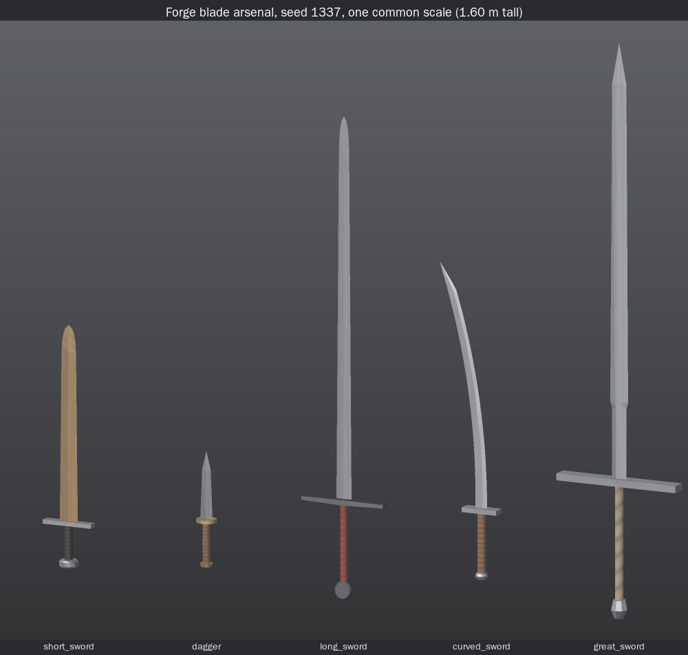
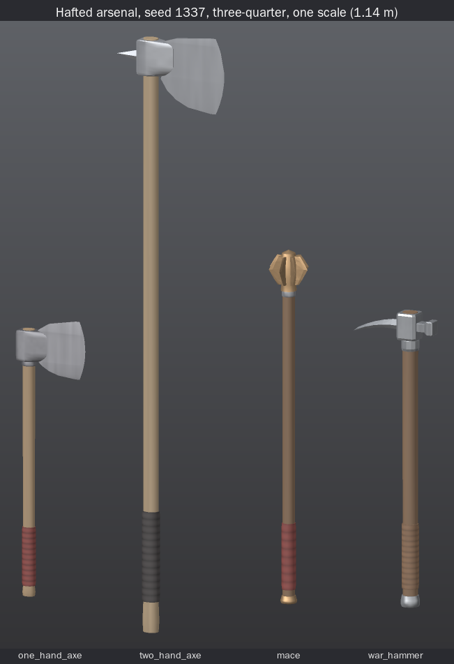
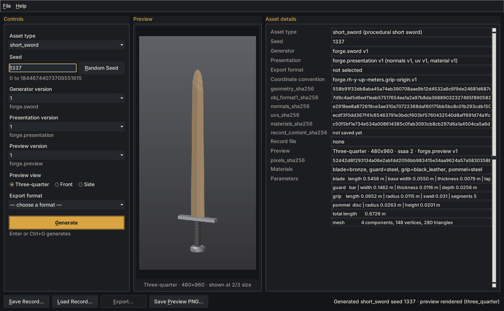
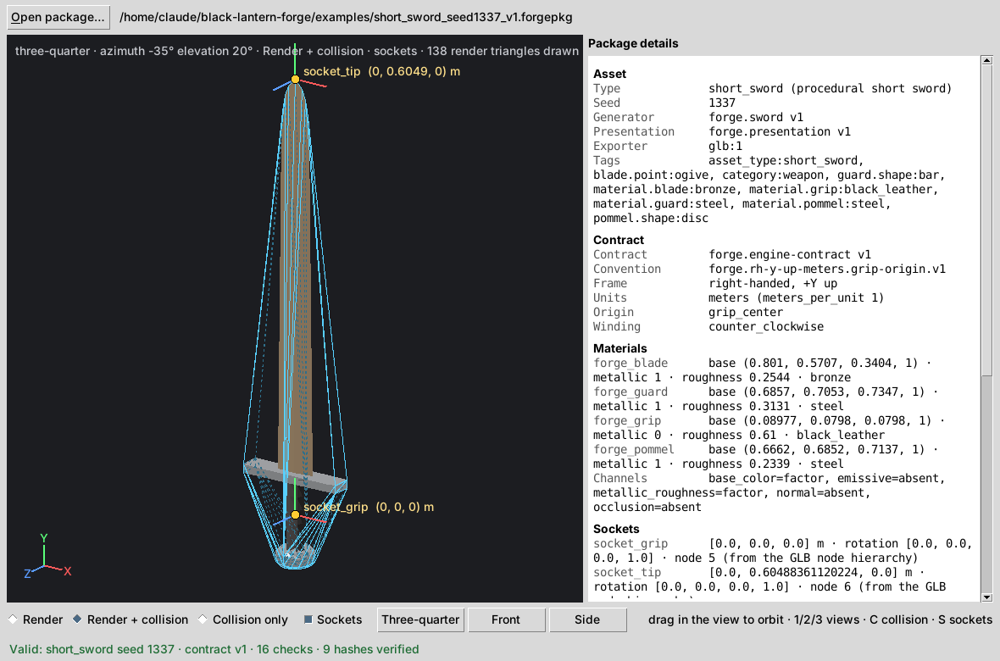

# Black Lantern Forge

Forge is the procedural asset generator for the Black Lantern ecosystem.

| Step | Claim | Status |
|---|---|---|
| 1 | Black Lantern Forge can deterministically generate a procedural short sword from an explicit seed and export the resulting geometry as OBJ. | **Frozen** |
| 2 | Black Lantern Forge can deterministically derive presentation data for a frozen procedural short sword, persist the asset recipe, reload it, and reproduce a local textured preview without changing the frozen sword geometry. | **Frozen** |
| 2.5 | Black Lantern Forge resolves asset generation, presentation, persistence, preview, and export behavior through explicit versioned registries while preserving the frozen short-sword outputs. | **Frozen** |
| 2.75 | Black Lantern Forge can be launched as a local desktop application that uses the frozen registry-driven pipeline to generate, preview, save, load, and export supported assets without changing frozen asset behavior. | **Frozen** |
| 3 | Black Lantern Forge can deterministically export a supported asset as a GLTF 2.0 binary package conforming to Forge → Engine Asset Contract v1 without changing frozen asset-generation behavior. | **Frozen** |
| 4 | An independent engine-side consumer can validate and ingest a Forge → Engine Contract v1 package, render its asset geometry, locate its declared sockets, and inspect its collision representation without using Forge generation code. | **Frozen** |
| 5A | Black Lantern Forge can deterministically generate, present, persist, preview, export, validate, and independently ingest multiple registered rigid blade weapon families without changing frozen short-sword behavior. | **Frozen** |
| 5B | Black Lantern Forge can deterministically generate, present, persist, preview, export, validate, and independently ingest multiple registered rigid hafted weapon families without changing frozen blade-family behavior. | **Frozen** |

Step 5A registers four rigid blade families next to the frozen short sword: `dagger`,
`long_sword`, `curved_sword` and `great_sword`. See [ARSENAL_BLADES.md](docs/ARSENAL_BLADES.md).



Step 5B registers four rigid hafted families through the same generic code: `one_hand_axe`,
`two_hand_axe`, `mace` and `war_hammer`. No generic module changed. See
[HAFTED_WEAPONS.md](docs/HAFTED_WEAPONS.md). Step 5B is frozen. Before the freeze, a realism pass gave the axes a
forged eye and adjusted two war-hammer bounds; those outputs are part of the original v1 definition.



**Not yet:**

- No spears, polearms, crossbows, firearms, flails or other flexible weapons. The bayonet exists
  only as an unregistered lineage schema; nothing mounts anything.
- The Step 4 viewer is a stand-in consumer that proves the contract can be read
  from the artifact alone. No real game engine has imported a package: there's
  no Unreal, Unity or Godot integration, and no runtime or gameplay use.
- No production textures.
- No standalone executable.

Those come later.



## Requirements

- Python 3.10+ (full suite verified on CPython 3.10, 3.11, 3.12, 3.13)
- No third-party dependencies, in any step.
- Forge Desktop (optional) needs Tkinter, which ships with python.org Python. On
  Debian/Ubuntu: `sudo apt install python3-tk`. The CLI never needs it. Tests use the standard library `unittest`.

## Quick start

From the repository root:

```bash
# Step 2.75: the desktop app (no CLI needed)
python -m forge_desktop            # or: python -m forge.gui, or double-click launch_forge_desktop.pyw

# Step 1: geometry only (unchanged)
python -m forge sword --seed 1337

# Step 2: also save an asset record and render a preview
python -m forge sword --seed 1337 --save output/seed1337.json --preview output/seed1337.png

# Reload the record: validate, regenerate, verify every stored hash
python -m forge load output/seed1337.json

# Render (and verify) the preview from the record alone
python -m forge preview output/seed1337.json

# Enriched OBJ with UVs, normals, and an .mtl (opt-in; obj_format 2)
python -m forge sword --seed 1337 --obj-format 2 --out output/seed1337_rich.obj

# Step 2.5: generic, registry-routed form. Every version is explicit.
python -m forge generate short_sword --seed 1337 --generator-version 1 --export obj:1
python -m forge generate short_sword --seed 1337 --generator-version 1 --presentation-version 1 \
    --export obj:2 --save output/seed1337.json --preview output/seed1337.png

# Step 3: Forge -> Engine contract v1 package (asset.glb + manifest.json in a .forgepkg directory)
python -m forge generate short_sword --seed 1337 --generator-version 1 --presentation-version 1 --export glb:1
python -m forge export output/seed1337.json --format glb:1 --out output/seed1337.forgepkg
python -m forge validate-package output/seed1337.forgepkg --reproduce

# Step 4: the independent engine-side viewer (reads the package; imports nothing from forge)
python -m forge_engine_viewer examples/short_sword_seed1337_v1.forgepkg                  # window
python -m forge_engine_viewer examples/short_sword_seed1337_v1.forgepkg --validate-only  # no GUI
python -m forge_engine_viewer examples/short_sword_seed1337_v1.forgepkg --dump-summary   # no GUI

# Step 5A: blade families, through the same generic commands (every version explicit)
python -m forge generate dagger --seed 1337 --generator-version 1 --presentation-version 1
python -m forge generate curved_sword --seed 7 --generator-version 1 --presentation-version 1 \
    --save output/curved7.json --preview output/curved7.png --export glb:1 --out output/curved7.forgepkg
python -m forge_engine_viewer examples/great_sword_seed1337_v1.forgepkg --validate-only

# Step 5B: hafted families, through the same generic commands (every version explicit)
python -m forge generate war_hammer --seed 1337 --generator-version 1 --presentation-version 1
python -m forge generate two_hand_axe --seed 42 --generator-version 1 --presentation-version 1 \
    --save output/axe42.json --preview output/axe42.png --export glb:1 --out output/axe42.forgepkg
python -m forge validate-package output/axe42.forgepkg --reproduce
python -m forge_engine_viewer examples/mace_seed1337_v1.forgepkg --validate-only
```

Example outputs live in `examples/`:

- `asset_record_seed1337.json`
- `preview_seed1337_three_quarter.png`
- the Step 3 golden package `short_sword_seed1337_v1.forgepkg/`
- its recorded hashes, in `engine_package_seed1337.golden.json`
- Step 5A goldens for each blade family (seed 1337): `<family>_record_seed1337.json`,
  `<family>_preview_seed1337_three_quarter.png`, `<family>_seed1337_v1.forgepkg/`, and every
  hash, socket and collision count in `arsenal_seed1337.golden.json`
- Step 5B goldens for each hafted family (seed 1337), with the same file names, and every hash,
  socket, collision count and overall dimension in `hafted_seed1337.golden.json`

### Forge Desktop

A Tkinter window over the same registry pipeline: generate, switch preview views,
save/load records, export `obj:1` / `obj:2` / `glb:1` (engine package), save preview PNGs. Records it saves
are standard Step 2 records the CLI loads. See [DESKTOP.md](docs/DESKTOP.md). Since Step 5A it lists the
asset types from the registry (nine since Step 5B); with several registered, none is preselected.

### `sword`

| Flag | Meaning |
|---|---|
| `--seed N` | Required. Decimal integer in `[0, 2**64-1]`. |
| `--generator-version V` | Generator version. Pinned default `1`; it does not track newer registrations. Always recorded. |
| `--out PATH` | Output `.obj` path (default `output/short_sword_seed<N>_v<V>.obj`). |
| `--json` | Print the full parameter record as JSON instead of the summary. |
| `--obj-format {1,2}` | `1` = Step 1 geometry-only OBJ (default, byte-identical to Step 1). `2` = enriched OBJ + MTL. |
| `--save RECORD.json` | Write an asset record (Step 2). |
| `--preview IMAGE.png` | Render a PNG preview (Step 2). |
| `--view`, `--width`, `--height`, `--ssaa` | Preview settings: `three_quarter`/`front`/`side`, default 480×960, 2×2 supersampling. |

`sword` is a pinned alias of `generate short_sword` (generator 1, presentation 1, export `obj`).

### `generate ASSET_TYPE --seed N --generator-version V [...]` (Step 2.5)

Generic form for any registered asset type. There are no version defaults:
`--generator-version` is always required, and `--presentation-version` is
required for `--save`, `--preview`, or a presentation export. Use
`--export FORMAT:VERSION` (e.g. `obj:1`, `obj:2`) with an optional `--out`. Unknown
asset types, formats, and versions exit 2 with the registered options listed.

Registered asset types: `short_sword` (exports `obj:1`, `obj:2`, `glb:1`), and since Step 5A
`dagger`, `long_sword`, `curved_sword` and `great_sword` (exports `glb:1`, `obj:2`; `obj:1` is the
frozen short-sword format and is refused for them), and since Step 5B `one_hand_axe`,
`two_hand_axe`, `mace` and `war_hammer` (the same exports as the blade families).

### `load RECORD.json [--out PATH [--obj-format {1,2}]] [--json]`

Validates the record, regenerates the frozen sword and its presentation, and
checks every expectation in the record. It can also re-export the reproduced
sword to OBJ.

### `preview RECORD.json [--out IMAGE.png] [--view ...] [--width ...] [--height ...] [--ssaa ...]`

Renders from the record. If the record stores a pixel hash and you don't
override the settings, the render is verified against it. The default output is
`<record dir>/<record stem>_<view>.png`.

### `export RECORD.json --format FORMAT:VERSION [--out PATH] [--json]` (Step 3)

Loads and fully verifies the record, then exports the reproduced asset in an
explicit format through the registry, e.g. `--format glb:1`. The default output
is `output/<asset_type>_seed<N>_v<V><ext>`.

### `validate-package PACKAGE [--reproduce] [--json]` (Step 3)

Checks an engine package with the independent validator, which needs no
generator. `--reproduce` also regenerates the package through the registry and
requires byte-identical `asset.glb` and `manifest.json`. See
[FORGE_ENGINE_CONTRACT_V1.md](docs/FORGE_ENGINE_CONTRACT_V1.md).

**Exit codes:**

- `0`: success.
- `2`: invalid input. Bad seed, unknown asset type or format, unsupported
  version, malformed record, bad flags. Nothing is written.
- `3`: something failed verification:
  - a record that doesn't reproduce
  - a package that fails validation
  - a package that doesn't reproduce

### From Python

```python
from forge import generate_sword, write_obj
from forge.presentation import PRESENTATION_V1, derive_presentation
from forge.record import build_record, save_record, load_record
from forge.render import DEFAULT_PREVIEW, render_preview, write_preview_png

sword = generate_sword(seed=1337, generator_version=1)        # frozen Step 1; both args required
presented = derive_presentation(sword, PRESENTATION_V1)       # normals, UVs, materials; explicit versions
image = render_preview(presented, DEFAULT_PREVIEW)
save_record(build_record(presented, image), "output/seed1337.json")
write_preview_png(image, "output/seed1337.png", presented)

loaded = load_record("output/seed1337.json")                  # regenerates + verifies
loaded.verified   # ('record_content_sha256', 'materials', 'geometry_sha256', ...)
```

## Architecture

Since Step 2.5, generic code (record loading, CLI routing, export, preview,
integrity hashing) resolves everything through explicit `(id, version)`
registries. The short sword is one registered asset type. See
[ARCHITECTURE.md](docs/ARCHITECTURE.md) for the registries, identifiers, how to add
a family, and why it isn't a plugin system.

```
record / CLI ─▶ registry.asset("short_sword") ─▶ generator ("forge.sword", 1)
             ─▶ presentation ("forge.presentation", 1) ─▶ exporter ("obj", 1|2) / preview ("forge.preview", 1)

record / CLI ─▶ registry.asset("curved_sword") ─▶ generator ("forge.curved_sword", 1)        (Step 5A; same
             ─▶ presentation ("forge.blade-presentation", 1) ─▶ exporter ("glb", 1 | "obj", 2)  generic code)
             ─▶ preview ("forge.preview.fit", 1)

record / CLI ─▶ registry.asset("mace") ─▶ generator ("forge.mace", 1)                          (Step 5B; same
             ─▶ presentation ("forge.hafted-presentation", 1) ─▶ exporter ("glb", 1 | "obj", 2) generic code)
             ─▶ preview ("forge.preview.fit", 1)
```

The frozen layers underneath:

```
seed ─▶ generate_sword(seed, generator_version)      Step 1, FROZEN. The geometry authority.
            │  SwordAsset (immutable)
            ▼
        derive_presentation(asset, versions)          Step 2. Reads geometry, never writes it.
            │  PresentedSword = asset + per-component face-varying
            │  normals, UVs (+ index triples) and a Material
            ├──▶ render_preview(presented, settings) ─▶ PNG   (software rasterizer)
            ├──▶ export_obj(asset)            obj_format 1 (Step 1 bytes, unchanged)
            ├──▶ export_enriched_obj(...)     obj_format 2 + .mtl (opt-in)
            └──▶ build_record(...) ─▶ JSON    the recipe; reload = regenerate + verify
```

Step 3 adds `forge/engine/`:

- **Package writer.** A direct GLB writer, an exact convex hull and a manifest.
  Generic code reaches it only through the export registry (`glb`, `1`).
- **Independent validator.** It checks packages on its own.

Step 4 adds `forge_engine_viewer/`, a separate top-level package that consumes
packages. The dependency runs one way: Forge writes the package, and the viewer
reads it. The viewer imports nothing from `forge`; it has its own GLB reader,
contract table and hash code. See [FIRST_INGESTION.md](docs/FIRST_INGESTION.md).



Step 5A adds `forge/blades/` (shared blade geometry, parameter model, four generators, the
blade presentation family and the bayonet-lineage schema), `forge/assets/blades.py`
(registration) and `forge/render/fit.py` (geometry-bound preview framing). Every generic
module (records, registry, CLI, hashing, exporters, engine contract, desktop, viewer) is
byte-identical to Step 4, and tests enforce that. See [ARSENAL_BLADES.md](docs/ARSENAL_BLADES.md).

Step 5B adds `forge/hafted/` (shared haft, grip, butt-cap and head primitives, the parameter
model with two-phase plausibility checks, four generators, and the hafted presentation family)
and `forge/assets/hafted.py` (registration and engine adapters). The only other product files
touched are `forge/catalog.py` (the explicit entry list), the version in `forge/__init__.py`
and `pyproject.toml`. Every generic module and every Step 5A blade source is byte-identical, and
tests enforce that. See [HAFTED_WEAPONS.md](docs/HAFTED_WEAPONS.md).

Docs:
[HAFTED_WEAPONS.md](docs/HAFTED_WEAPONS.md) (hafted families, Step 5B) ·
[ARSENAL_BLADES.md](docs/ARSENAL_BLADES.md) (blade families, Step 5A) ·
[FIRST_INGESTION.md](docs/FIRST_INGESTION.md) (engine-side viewer, Step 4) ·
[FORGE_ENGINE_CONTRACT_V1.md](docs/FORGE_ENGINE_CONTRACT_V1.md) (engine contract, Step 3) ·
[DESKTOP.md](docs/DESKTOP.md) (desktop app, Step 2.75) ·
[ARCHITECTURE.md](docs/ARCHITECTURE.md) (registries, Step 2.5) ·
[PRESENTATION.md](docs/PRESENTATION.md) (normals, UVs, materials) ·
[PREVIEW.md](docs/PREVIEW.md) (renderer, camera, determinism boundary) ·
[PERSISTENCE.md](docs/PERSISTENCE.md) (record schema, versions, hashing, compatibility) ·
[DETERMINISM.md](docs/DETERMINISM.md) · [COORDINATES.md](docs/COORDINATES.md) ·
[SWORD_MODEL.md](docs/SWORD_MODEL.md)

## Seeds

A seed is a plain `int` in `[0, 2**64-1]`. Anything else (negative, too large,
`bool`, `float` even `1.0`, `str`, `None`, numpy ints) raises
`InvalidSeedError`, a `ValueError`. There's no coercion. On the CLI, and in asset
records, the seed is a string of ASCII decimal digits. Records use a string
because JSON numbers above 2**53 aren't portable.

## Determinism guarantees

- **Step 1 (frozen):** same `seed` + `generator_version` → identical
  parameters, bit-identical vertex data, identical faces, byte-identical
  obj_format 1 output.
- **Step 2:** additionally, same presentation versions → bit-identical normals
  and UVs, identical materials, byte-identical enriched OBJ/MTL, identical record
  content hash. Same preview settings → identical pixel buffer.
- Presentation randomness uses its own PCG32 streams (`forge.presentation.material.v1.*`),
  so it can't shift geometry randomness.
- **Step 3:** the same identity (asset type, seed, generator, presentation,
  exporter, contract) gives byte-identical `asset.glb` and `manifest.json`. That
  holds across processes, hash seeds, output folders and Python versions.
- **Step 5A:** the same holds for every blade family: geometry, presentation,
  records, preview pixels, OBJ 2 and engine packages. Each component draws from
  its own stream (`forge.<family>.<component>`), and curved blades use rational
  rotations with no trigonometry.
- **Step 5B:** the same holds for every hafted family. Haft, grip, head, bit/elements, collar and
  butt cap each draw from their own stream, and materials draw from
  `forge.hafted-presentation.material.v1.*`, so a material change cannot move geometry.
- Verified bit-identical on CPython 3.10–3.13 (x86-64 Linux). Other OSes and
  CPUs are argued, not yet tested. See [DETERMINISM.md](docs/DETERMINISM.md) and
  [PREVIEW.md](docs/PREVIEW.md).

## Coordinate system

Right-handed, **+Y up**, **meters**. Blade tip points **+Y**, blade edges along
±X, blade flats face ±Z. **Origin = center of the grip.** Triangles wind
counter-clockwise seen from outside, so normals point outward. Previews keep
+Y as screen-up. Full layout: [docs/COORDINATES.md](docs/COORDINATES.md).

## Run the tests

```bash
python -m unittest discover -s tests -v
```

626 tests in about 11 minutes; most of the time goes to tests that re-run earlier suites in fresh
interpreters.

- 68 frozen Step 1 tests: `test_prng`, `test_seed`, `test_determinism`,
  `test_geometry`, `test_obj_export`, `test_cli`
- 77 frozen Step 2 tests: `test_step2_*`
- 44 frozen Step 2.5 tests: `test_registry_*`
- 49 frozen Step 2.75 tests: `test_desktop_*`. The 3 real-window tests skip
  automatically without Tkinter or a display.
- 84 frozen Step 3 tests: `test_engine_*`. They cover the 56 numbered contract
  requirements plus extra fail-closed, hull, texture-slot, CLI and golden
  checks. Tests 53–56 re-run each earlier suite in a fresh interpreter at its
  frozen test count.
- 94 Step 4 tests: `test_viewer_*`. They cover the 68 numbered ingestion
  requirements plus refusal codes, fuzzed damage, contract drift, immutability
  and cross-process ingestion with Forge absent from disk. Tests 64–68 re-run
  every earlier suite at its frozen count. The real viewer-window test skips
  without Tkinter or a display.
- 112 Step 5A tests: `test_arsenal_*`. They cover the 71 numbered requirements
  plus the architecture test (generic sources byte-identical to Step 4, no family
  names or asset-type branches in generic code), contact and plausibility checks,
  stream isolation, the bayonet-lineage schema, and golden fixtures. Tests 66–71
  re-run every earlier suite at its frozen count. The real-window test skips
  without Tkinter or a display.
- 98 Step 5B tests: `test_hafted_*`. They cover the 72 numbered requirements plus the
  architectural source guard (generic sources and Step 5A blade sources byte-identical, no
  family names or branches in generic code), independent joint-seating checks, stream and
  material isolation, CLI and golden checks. Tests 66–72 re-run every earlier suite, Step 5A
  included, at its frozen count. The real-window test skips without Tkinter or a display.

Step 3 changed 9 assertion lines in 4 earlier test files, and nothing else. Those
lines pinned the export list to exactly `obj:1`/`obj:2`, and the short sword now
also offers `glb:1`. Step 4 changed no earlier test file. Step 5A made small,
disclosed edits to 7 earlier test files: assertions that pinned the catalog to one
asset type, and desktop tests that relied on the single-type preselection.
[ARSENAL_BLADES.md](docs/ARSENAL_BLADES.md#disclosed-edits-to-frozen-test-files)
lists every one. Step 5B made minimal, disclosed edits to 7 earlier test files: assertions that
pin the registry to exactly the Step 5A types and presentation accept-lists, and the Step 5A
new-file guard. [HAFTED_WEAPONS.md](docs/HAFTED_WEAPONS.md#disclosed-edits-to-frozen-test-files)
lists every one. No test count changed. `pytest` also works if installed, but isn't required.

## Layout

```
forge/
  __init__.py, __main__.py, cli.py   public API, python -m forge
  errors.py, versioning.py           exception hierarchy, strict version checks
  seed.py, prng.py, determinism.py   seeds, PCG32, float-environment check      (Step 1)
  mesh.py, primitives.py             Mesh + validation, loft primitives         (Step 1)
  sword/                             generate_sword(), params, SwordAsset, v1.py (Step 1, frozen)
  export/obj.py                      obj_format 1 writer                         (Step 1, frozen)
  export/obj_enriched.py             obj_format 2 + MTL                          (Step 2)
  presentation/                      model, normals, uv, materials               (Step 2)
  render/                            settings, camera, raster, png               (Step 2)
  hashing.py                         canonical hashes                            (Step 2)
  record.py                          generic asset records via registry          (Step 2, generic since 2.5)
  registry.py                        registry types, build checks, dispatch      (Step 2.5)
  catalog.py                         the explicit list of registered entries     (Step 2.5)
  conventions.py                     known coordinate conventions by id          (Step 2.5)
  assets/short_sword.py              short_sword registration (wraps frozen code)(Step 2.5)
  assets/blades.py                   blade-family registration + engine adapters   (Step 5A)
  blades/                            blade families                                (Step 5A)
    shapes.py                        profiles, centerlines, sweep, guards, grips, pommels
    model.py, draws.py, build.py     parameter model + plausibility rules, stream draws, assembly
    dagger.py, long_sword.py, curved_sword.py, great_sword.py   the four v1 generators
    presentation.py                  forge.blade-presentation v1 (normals, UVs, materials)
    lineage.py                       blade classes + bayonet lineage schema (not registered)
  render/fit.py                      forge.preview.fit v1: geometry-bound framing  (Step 5A)
  assets/hafted.py                   hafted-family registration + engine adapters  (Step 5B)
  hafted/                            hafted families                               (Step 5B)
    shapes.py                        profiles, haft loft, rings, butt caps, socket blocks, slice stacks, sweeps
    model.py, haft.py                parameter model + plausibility helpers, joints; shared haft/grip/cap
    axe.py                           shared axe head + bit (both axe families)
    one_hand_axe.py, two_hand_axe.py, mace.py, war_hammer.py   the four v1 generators
    presentation.py                  forge.hafted-presentation v1 (normals, UVs, materials)
  gui.py                             `python -m forge.gui` launcher               (Step 2.75)
  engine/                            Forge -> Engine contract v1                  (Step 3)
    contract.py                      the versioned contract table (names, values, schema, hash coverage)
    glb.py                           direct GLB writer (stdlib only, byte-stable)
    hull.py                          exact-integer convex hull (collision_hull)
    package.py                       build + write asset.glb + manifest.json
    validate.py                      independent validator / GLB parser (fail closed)
forge_desktop/                       the desktop SHELL, kept outside the core     (Step 2.75)
  window.py                          Tk widgets (the only module importing tkinter at load)
  session.py                         window state + user intents, headless
  controller.py                      registry pipeline bridge
  entropy.py                         Random Seed button (UI convenience only)
  app.py, __main__.py                entry point
forge_engine_viewer/                 independent engine-side CONSUMER; imports nothing from forge (Step 4)
  contract_v1.py                     its own copy of the Contract v1 constants (drift-tested against Forge's)
  glb.py                             its own GLB reader + bounds-checked accessor decoding
  ingest.py                          validate -> parse -> decode -> sockets/collision/LOD -> immutable model
  render.py                          headless draw lists: views, shading, overlays, viewer-space transform
  summary.py, session.py             text/JSON summaries; window state (no Tk)
  window.py                          Tk canvas + details panel (the only module importing tkinter)
  cli.py, __main__.py                python -m forge_engine_viewer [--validate-only | --dump-summary]
launch_forge_desktop.pyw             double-click launcher
tests/      unittest suite (test_step2_* = Step 2, test_registry_* = Step 2.5, test_desktop_* = Step 2.75,
            test_engine_* = Step 3, test_viewer_* = Step 4, test_arsenal_* = Step 5A,
            test_hafted_* = Step 5B)
docs/       see links above
examples/   API example, example asset record, example preview, golden engine packages + hashes
            (short sword, since Step 5A each blade family, since Step 5B each hafted family)
output/     generated files (git-ignored)
```

## Current limitations

- Nine asset types: the short sword, four blade families and four hafted
  families, all with deliberately simple swept, lofted and stacked shapes.
  Components are separate closed shells that touch or are seated into each
  other, not welded. The families are plausible envelopes, not historical presets.
- Hafted heads are low-poly solid steel estimates. The axe eye is a forged teardrop
  with tapering cheeks, but its hole isn't modelled (the haft is a separate solid
  inside it), and mace cores are solid. See
  [HAFTED_WEAPONS.md](docs/HAFTED_WEAPONS.md#14-known-limitations).
- Contract v1 sockets carry identity rotations, so a curved blade's
  `socket_tip` gives the tip's position, not its direction, and a hafted
  weapon's `socket_strike` gives the striking point, not the striking direction.
- Straight blades are flat-shaded (faceted normals), so ogive tips look low-poly.
  Faint triangulation seams can appear on blade flats (≤ ~7° normal difference).
- UVs are simple per-component projections: no packing and no texel-density
  balancing. Front and back blade faces share mirrored UVs.
- Materials are a small preset palette with per-seed variation. Patterns are
  procedural and used by the preview only. No texture images are baked or
  exported; the GLB carries PBR factors only (see the contract doc).
- Engine packages are LOD0 only, and the collision is one convex hull.
  Sockets are identity-rotation frames derived from the asset axes. Nothing has
  been verified inside a game engine.
- The preview is an orthographic, non-physically-based software render. It's
  pure Python, so it takes about 2–3 s at the default 480×960 with 2×2 supersampling.
  Bronze blades can read a little matte.
- Byte-stable PNG files aren't guaranteed across zlib builds. The deterministic
  claim for previews is the pixel hash.
- Records carry no timestamps. The frozen Step 1 tests ban clock access in the
  package, and this also keeps saved records byte-reproducible.
- Byte stability is verified only on CPython / x86-64 Linux. Other platforms are
  argued from IEEE-754, not tested.

- Some short-sword coupling remains inside frozen modules: the OBJ format 1
  exporter only accepts sword assets, presentation v1's tables are keyed by
  sword components, and preview v1 framing is sized for the sword. See
  [ARCHITECTURE.md](docs/ARCHITECTURE.md#remaining-short-sword-coupling).

- Forge Desktop is tested on Linux/X11 (Tk 8.6 and 9.0) under a virtual display,
  but not yet on real Windows or macOS desktops. See [DESKTOP.md](docs/DESKTOP.md#known-limitations).

- The Step 4 viewer is an inspection tool, not an engine or a production renderer:
  - Its shading is an approximation driven by the PBR factors, drawn with a
    painter's algorithm.
  - It refuses textured packages.
  - It reads Contract v1 only.

  See [FIRST_INGESTION.md](docs/FIRST_INGESTION.md#15-known-limitations).

## Deferred (explicitly NOT in Step 5B)

- **Distribution:** standalone executable / app bundle.
- **Weapons:** spears, polearms, crossbows, firearms; a working bayonet mount;
  flexible or chain weapons (flails, whips); projectiles; historical presets;
  damage models and gameplay stats.
- **Content:** armor, creatures, buildings, worlds.
- **Textures and geometry:** baked texture images (and a byte-stable PNG encoder
  for them), LOD1+, multi-hull collision.
- **Engines:** Unreal/Unity/Godot importers or plugins (including axis/unit
  conversion and collider cooking), runtime sockets or physics, weapon equipping,
  gameplay.
- **Tools:** shader authoring, asset browser / registry service, package editing
  or repair, hot reload.
- **Animation:** animation, rigging and physics.
- **Other:** AI generation, network storage / cloud sync, multiplayer, dynamic
  plugins or runtime code loading, Black Lantern OS.
