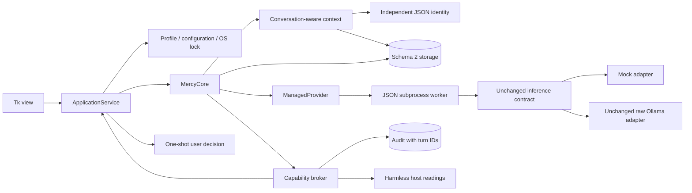

# Mercy v0.2 — The Vessel: engineering report

September 28, 2026. This milestone implements and tests application foundations
using mock inference. It does not complete or reopen Acceptance 001. The frozen
v0.1 release, profile and evidence remain unchanged. Real-model acceptance is
still deferred to the tower.

## Implemented architecture



The view presents service events and decisions. The service owns one operation,
configuration, profile ownership, permission requests and shutdown. Core owns
turn orchestration. Storage owns transactions. Provider subprocesses perform
inference/status only; they receive no broker or database object. Trusted
application code registers provider factories; user config and model text cannot
choose arbitrary module imports. Process separation is lifecycle isolation, not
an OS sandbox against malicious installed provider code.

## Delivered priorities

| Requested foundation | Implementation and evidence |
| --- | --- |
| Transactional persistence | User message, assistant placeholder and running turn are committed atomically. Checkpoints retain partial text; terminal turn/message updates share one transaction. |
| Recovery | Profile owner marks abandoned running turns interrupted without automatic replay. A subprocess crash test confirms committed partial text survives and the lock releases. |
| Cancellation/deadlines | Managed provider process is terminated on cancellation/deadline; status and generation are bounded separately. Permission waits share the generation deadline. Parent-pipe EOF stops orphan workers. |
| Migrations | Explicit schema 2, pre-upgrade SQLite backup, transactional DDL, unknown-schema rejection, rollback and idempotent reopening. |
| Conversations | Separate persisted conversations and selected ID. Context/history are scoped; complete new turns are selected as units. Legacy messages retain their original data. |
| Memory | Explicit notes with user/conversation/import provenance, legacy label for imported v1 records, source turn validation, detail view, confirmed deletion and content-free audit metadata. |
| Profile/config safety | Separate default v0.2 path, OS-held exclusive locks, strict fields/ranges, loopback endpoints, atomic config replacement, fail-closed invalid files. |
| Providers | Mock and retained Ollama selection/check through a trusted registry and a UI-independent service. No cloud adapter, model installation or contract changes. |
| Audit | Turn correlation, pagination/filtering, separate request/approval/execution phases, malformed argument redaction, observable tool-limit rejections. |
| Replaceable UI | Tk no longer constructs Core/providers or controls worker internals; ApplicationService exposes start/cancel/configure/session/permission operations and events. |

No dangerous capabilities were introduced. Existing version/time/coarse system
information capabilities still require per-call authorization. A late approval
cannot revive an expired or cancelled request.

## Decisions and tradeoffs

**SQLite transactions rather than an event-sourcing rewrite.** The existing
schema is extended with conversations/turns and provenance. Existing data stays
readable; explicit state transitions provide recovery with a small implementation.
Legacy rows are assigned conversation 1 without inventing old turn boundaries.

**Provider subprocesses rather than trying to kill Python threads.** A backend
can block inside network I/O. The runtime can terminate its process without
changing the provider protocol. Workers send JSON, avoiding unpickling model
output. A bounded 32-item queue limits transport buffering. A parent-liveness
pipe prevents a worker remaining alive after abrupt parent exit. Internal worker
factories remain trusted code; this is not a plugin security sandbox.

The first transport implementation used multiprocessing named pipes, which this
Windows host denied. It was replaced with standard subprocess pipes, verified
here. No permission or security setting was weakened to accommodate it.

**Explicit one-operation ownership.** The service prevents provider/session
changes during generation, correlates permission IDs and rejects stale responses.
Closing requests cancellation before releasing the profile. UI permission dialogs
are nonblocking so Cancel and deadline processing continue while they are open.

**Conservative memory management.** Notes remain user-created; optional references
link notes to existing completed turns. Deletion removes the active row and records
metadata, without copying deleted content into audit. Secure erase, semantic
memory and autonomous fact extraction are not implemented.

**Separate default profile.** A default v0.2 launch cannot accidentally migrate the
v0.1 default directory. Explicit migration requires pointing at a copy. Database
backups are automatic; identity is not overwritten and legacy config loads defaults.

**Functional UI changes only.** Added controls expose the foundations; there is
no avatar, theme redesign, voice surface or polished Black Lantern shell.

## Dependencies and file inventory

Runtime: Python standard library, SQLite, Tcl/Tk. Build only: setuptools >=68.
No new runtime dependency or cloud service. The exact added/modified/unchanged
release-file inventory and per-file hashes are in `CHANGED_FILES.json`, compared
against the original v0.1 release ZIP. The original provider implementation and
default identity JSON are byte-for-byte unchanged.

The README contains the file tree and installation/use instructions. New central
modules are application, config, profile, migrations, runtime and worker. Core,
storage, context, capability correlation, platform locking and UI are updated.

## Tests and exact evidence

Final environment: Windows 11, Python 3.12.14, 64-bit AMD64.

```text
python -m unittest discover -s tests -v
Ran 67 tests in 12.408s
OK
```

**67 passed, 0 failures, 0 errors, 0 skipped** on this Windows host. Full output is
in `TEST_RESULTS.txt`. The original 32 baseline cases remain. One expected audit
count was updated from nine to ten because rejected tool-round limits now produce
an explicit audit record. This is documented behavior, not a removed assertion.

Meaningful slices were tested incrementally: storage passed 38 tests; bounded
runtime passed 46; controller integration passed 56; further failure cases passed
66; parent-crash worker cleanup brought the final suite to 67.

The initial storage test run caught open SQLite handles in a migration backup
and test fixture; explicit closure fixed them. The first runtime run exposed the
named-pipe environment restriction described above. Subsequent full runs passed.

Additional coverage includes:

- cancellation and deadline of a stuck backend with verified worker termination;
- worker failure and Windows process-handle verification of exit after parent crash;
- actual abrupt application-process exit followed by profile/turn recovery;
- cross-process profile contention and release;
- cancelled/expired permissions, stale approvals, and one-use decisions;
- atomic config failure, invalid config/identity and invalid memory provenance;
- migration rollback, schema rejection and preservation of v1 data;
- memory creation/deletion rollback on audit-write failure;
- conversation separation, selection persistence and audit pagination/filtering.

### Tk smoke

Command: `python -m tests.ui_smoke --data-dir <unused disposable directory>`

```text
PASS: Tk startup, streaming, permission buttons, memory provenance/deletion, session switching, cancel pending permission, audit filter, restart persistence
```

Full output: `TK_SMOKE_RESULTS.txt`. This runs real Tk widgets and workers with
programmatic button actions and substituted text/deletion confirmations. It is
not a human visual/usability review. No new user desktop screenshot review was
performed for v0.2.

### Migration rehearsal

`MIGRATION_EVIDENCE.json` records a successful migration of a copy extracted from
the frozen Acceptance snapshot. History, marker, identity and legacy provenance
were verified. The automatic backup was opened separately and checked for schema
1 and exact original table rows. A second opening created no additional backup.
The original Acceptance profile was never opened by v0.2.

### Packaging

A `py3-none-any` wheel was built successfully with the already-installed setuptools
using its direct `bdist_wheel` command. This emitted a setuptools deprecation
warning; standard build frontends are preferred on a normal development machine.
The wheel payload was extracted into a separate directory and successfully ran
profile creation, a subprocess mock turn and shutdown from those packaged modules.

An offline `pip install --no-index --no-deps --no-compile --target ...` attempt was
blocked by this host's private temporary-directory ACL (`WinError 5`). Pip
installation and a clean-machine installation are therefore **not verified**.
Source launch requires no pip installation. See `PACKAGING_EVIDENCE.json`.

## Frozen acceptance evidence

`FROZEN_ARTIFACT_CHECK.json` records the final comparison against the manifest
captured before development: 65 tracked v0.1/Acceptance files, zero changes.
The snapshot includes the original Downloads ZIP/checksum, Acceptance outputs,
source and profiles. v0.2 artifacts live separately. No Acceptance report was
edited to imply real inference had succeeded.

## Limitations and technical debt

- Real Ollama inference, persona quality, model switching, tool compatibility,
  actual backend recovery and GPU behavior remain unverified and deferred.
- Windows 3.12 was tested. Python 3.11 compatibility is declared but not separately
  executed. Linux/macOS locks and GUI behavior have not been validated here.
- This is a sturdier prototype, not a hardened production agent service. Data and
  backups are plaintext and audits are not tamper-evident. No secure erase exists.
- Profile locks coordinate v0.2 instances; they cannot make v0.1 or arbitrary local
  software honor ownership. Do not run versions together on the same database.
- Cancellation is bounded around provider waits and permission waits, not a hard
  real-time guarantee for OS scheduling or blocked disk I/O. SQLite may wait up to
  five seconds. Termination allows short cleanup waits. If the OS itself stops
  responding, ordinary application guarantees do not apply.
- Checkpointing each received text event favors durability over throughput and
  may need measurement with a real high-throughput backend. No model benchmark was
  performed or inferred from mock timing.
- Context remains character-based and note retrieval scans locally. No semantic
  search, token-aware summaries, automatic memory editing or conversation export.
- The UI displays the most recent 200 messages; older history remains in SQLite.
  Conversation rename/archive/delete controls are not implemented.
- Tool exchanges remain in audit rather than being reconstructed as provider
  tool messages across later turns. Interrupted generation is never auto-resumed.
- Permission timeouts count against the generation deadline; a slow user may need
  to send another request. This is explicit and configurable, not a persistent grant.
- A trusted provider runs with the user's process privileges. Registry installation
  is a trusted-code operation, not a model-accessible capability.
- No GPU resource arbitration, cloud backend, secure key store, voice/avatar/media,
  Forge integration or Black Lantern OS API is implemented.

## Recommended next milestone and stop point

Deploy the unchanged v0.1 Acceptance 001 bundle on the tower and resume its exact
real-backend readiness / Stage 6 checkpoint. Keep that acceptance profile distinct
from a copied profile used to validate v0.2. Then separately test v0.2 cancellation,
timeouts, recovery and provider behavior against the chosen real local model.
Do not merge mock evidence into real-inference acceptance.

v0.2 implementation ends here. No v0.3 feature work was begun.

**Keep the Lantern Lit.**
