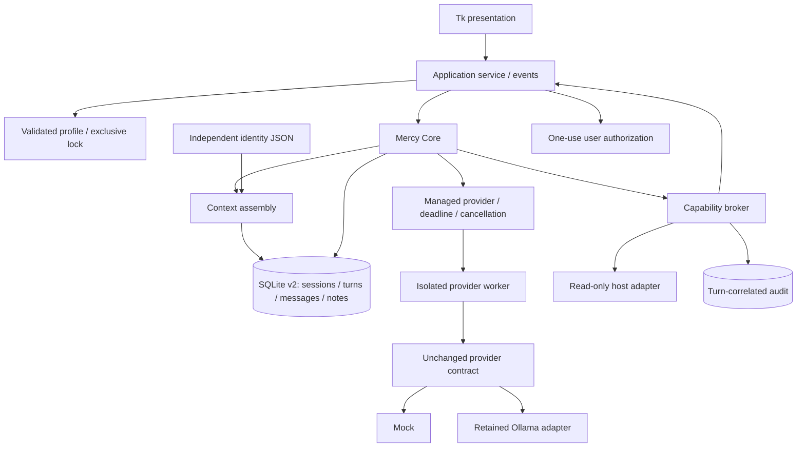

# Black Lantern Mercy v0.2 — The Vessel

Mercy is a local-first assistant whose identity, memories, conversations and
permissions persist independently of the model. The Vessel strengthens that
application foundation using the offline mock provider. It does not demonstrate
real inference. Acceptance 001 remains frozen and its real-model checks remain
blocked for the user's tower.

## Windows quickstart

Install Python 3.11+ with Tcl/Tk, extract this source project, and run from its
directory:

```powershell
py -3 -m mercy
```

Or double-click `launch.cmd`. If the Python launcher is unavailable, use the full
path of your Python executable with `-m mercy`. Runtime dependencies are Python's
standard library, Tcl/Tk and SQLite; there are no third-party runtime packages.
There are no model downloads or cloud services in setup.

The default profile is **`%LOCALAPPDATA%\BlackLantern\Mercy-v02`**, separate from
v0.1. Linux's default is `~/.local/share/black-lantern-mercy-v02` (not verified here).
The application starts with **mock**, labeled as an offline demonstration.

Type `Mercy?` for a streamed mock greeting. Type `/time` for the existing harmless
capability demonstration. Its dialog defaults to Deny and offers Allow once.
These responses are mock development evidence, not real First Voice acceptance.

## What changed

- Conversations have separate history and a persisted selected conversation.
- Turns atomically create a user message and assistant placeholder. Partial text
  is checkpointed; terminal states distinguish complete, failed, cancelled,
  timed out and interrupted.
- Startup under an exclusive profile lock recovers unfinished turns as interrupted.
- Cancel and generation deadlines stop provider subprocesses, including blocked
  calls. Deadlines also cover permission waits. Status checks have their own limit.
- Database schema 2 upgrades schema 1 transactionally and creates a backup first.
- Durable notes record source kind, source reference and timestamps. Inspection
  shows provenance. Deletion removes the active row and writes content-free metadata.
- Config validation, atomic replacement and exclusive OS profile locks reduce
  accidental corruption and simultaneous-writer risk.
- Tk uses an application service for generation, permissions, provider selection
  and lifecycle. The inference contract and raw Ollama adapter remain unchanged.
- Audit records can be paged and filtered by turn ID. Limit rejections are observable.

## Using the interface

**Conversation:** select or create a conversation at the top. Send starts a turn;
Cancel stops the current operation. Failed/cancelled/interrupted text remains
visible with its state. Switching conversations or applying settings is blocked
while an operation is active. There is no automatic retry or continuation of an
interrupted generation; send a new message explicitly.

**Durable memory:** add an explicit note, inspect its full content and provenance,
or confirm deletion. Optionally link a new note to the latest completed turn of
the selected conversation. Without that option it is a user-authored note. Notes
are profile-wide, so they can be retrieved across conversations. Models cannot
autonomously create or delete notes.

**Provider / profile:** choose mock or the retained Ollama adapter, set an exact
model and loopback endpoint, and save/check. Configure a 1–600 second generation
deadline and 1–30 second status deadline. Settings are validated before replacement.
The tab also exposes the profile path and identity inspection. Edit the profile's
identity JSON outside the application and apply to reload it. Changing providers
does not replace identity or memory. Ollama installation and real inference are
intentionally deferred; this milestone adds no cloud backend or installer.

**Audit:** view 100 records per page, filter by a turn ID, or select the latest
turn. Intent, authorization and execution are distinct. A request is not proof of
execution. Memory actions log only IDs/provenance metadata, not note content.

Closing during work requests cancellation and waits for the worker/turn to settle
before releasing the profile. Normal shutdown should finish promptly. Disk I/O
delays can extend this; SQLite's busy timeout is five seconds.

## Profile compatibility and migrations

**Never point v0.2 at the frozen Acceptance 001 profile.** Close v0.1 and copy a
profile into a separate development directory first. Then:

```powershell
py -3 -m mercy --data-dir C:\path\to\copied-profile
```

v0.2 understands the v0.1 config fields and loads defaults for new fields.
Schema 1 is upgraded to schema 2 inside one transaction. Before touching a
versioned database it creates `mercy.sqlite3.pre-v2-TIMESTAMP.bak`. The backup
retains the schema-1 data. Legacy history is assigned to the first conversation;
legacy memory is labeled `legacy` rather than inventing provenance. Legacy message
rows retain their original state/text and do not receive fabricated turn IDs.

Unknown newer schemas and nonempty unversioned databases are rejected. A failed
migration rolls back. Reopening schema 2 does not remigrate or create extra backups.
There is no downgrade operation. To return to v0.1, use the untouched original copy
or restore the schema-1 backup to a separate directory while all apps are closed.
Do not open schema 2 with the old v0.1 program.

The OS-held `profile.lock` prevents a second v0.2 instance from opening the profile.
It releases on process exit; the file may remain and should not be manually deleted
to bypass ownership. v0.1 does not honor this lock, so never run both versions on
the same profile. Symbolic-link profile files are rejected; OS account permissions
remain the actual access boundary. Keep the profile on a local filesystem.

## Architecture



The provider worker receives messages and tool schemas, not a Store or broker.
Only its parent coordinates capability validation, authorization and execution.
Provider factories are registered by trusted code; configuration does not select
arbitrary imports or executables. The JSON subprocess transport is an internal
adapter around the unchanged `status()` / `stream(messages, tools)` contract.

```
mercy/
  application.py   UI-independent service, operation ownership, permission events
  profile.py       profile composition, ownership, startup recovery
  config.py        strict validation and atomic configuration replacement
  migrations.py    schema versioning, backup and transactional upgrade
  storage.py       conversations, turns, memory and audit persistence
  context.py       bounded, conversation-aware context assembly
  core.py          persisted turn and tool-loop orchestration
  runtime.py       cancellation/deadline control and managed provider processes
  worker.py        private JSON provider subprocess transport
  providers.py     unchanged mock/Ollama adapters and provider protocols
  capabilities.py explicit registry, argument validation, permissions and audit
  platform.py     OS paths, exclusive file locks, time and coarse system readings
  ui.py           Tk widgets, event presentation and user decisions
  identity.json   unchanged shipped persona
tests/            baseline regressions, v0.2 failure tests and Tk smoke
```

## Context and continuity

Context uses up to 40 messages within a 16,000-character budget. Complete new
turns are selected together, so a completed user/assistant pair is not truncated
in half. Failed, cancelled, timed-out and interrupted turns are excluded from
future inference context while remaining inspectable. The currently running
user message is included; assistant placeholders are not. Legacy unpaired rows
retain v0.1 suffix semantics. The selector inspects up to 200 recent rows.

Retrieval still uses deterministic word overlap, up to five relevant notes.
Whole notes are selected within a 3,000-character memory block, avoiding truncated
JSON. No embeddings or semantic memory were added. Character budgets are not
token counts; actual model context limits remain a tower-validation concern.

## Lifecycle and security

Cancel/deadline checks run approximately every 40 ms during provider and permission
waits. Process termination includes bounded waits; this is not a hard real-time
guarantee. A stdin liveness channel causes a worker to exit if its parent dies.
Workers are process-isolated for lifecycle management, **not sandboxed against
malicious Python code**. Only trusted installed provider implementations belong
in the registry. Raw adapters used outside ManagedProvider do not gain its bounds.

The three harmless capabilities remain version, local time, and coarse OS/CPU
architecture. No shell, unrestricted file tool, elevation, installer, autonomous
grant, plugin marketplace, cloud inference or self-modification was added.
Permission decisions apply once; stale IDs, cancellation and deadlines prevent
late approval. Capability intent and approval are committed before execution.

SQLite, JSON and backups are plaintext. Do not enter secrets in notes or chat.
Pattern detection is only defense in depth, not a comprehensive secret detector.
Deletion removes active notes but does not securely erase database pages, backups
or previous chat references. Audit is inspectable but not tamper-evident.

## Tests and packaging

```powershell
py -3 -m unittest discover -s tests -v
py -3 -m tests.ui_smoke --data-dir .\disposable-smoke-profile
```

Use an unused disposable directory for the Tk smoke. It requires Tcl/Tk and drives
actual widgets, but is automated rather than a human usability assessment. The
unit suite uses mock providers and local synthetic HTTP servers; no real model,
network service, account or GPU is required. A Windows-only test checks worker
exit after parent termination; it is skipped on other OSes.

Optional install from the provided wheel (see `DEPLOY_WINDOWS.md` for upgrade, backup and rollback):

```powershell
py -3 -m pip install --no-deps .\black_lantern_mercy-0.2.1-py3-none-any.whl
```

Source launch avoids installation. Building uses setuptools >=68; standard build
frontends may download that build dependency unless already available. See the
engineering report for exactly which build/install paths were verified here.

## Scope boundary

Known limits include plaintext data, no secure erase, linear note search, no
conversation deletion/export UI, no token-aware summaries, and no real-model
verification. Backend model residency/resource arbitration is unchanged. There
is no voice, avatar, media generation, Forge or Black Lantern OS integration.

Recommended next milestone: deploy to the tower and perform the deferred real
First Voice checks, then separately evaluate v0.2 lifecycle behavior against the
chosen backend. That work is not performed or authorized by this release.

**Mercy may ask for power. Mercy does not grant herself power.**

**Keep the Lantern Lit.**
