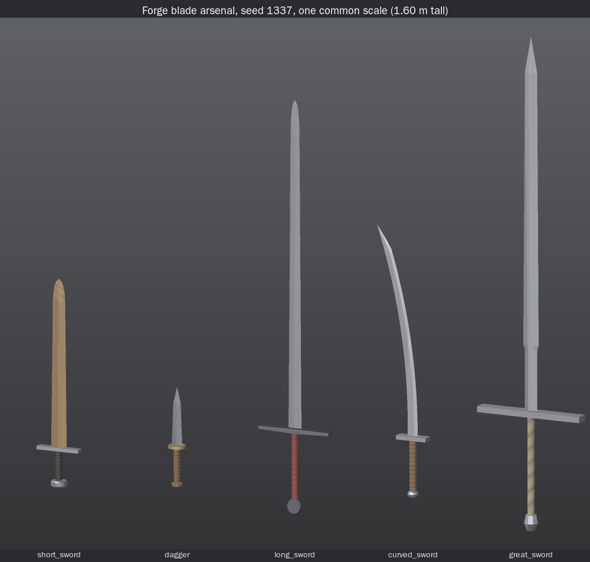
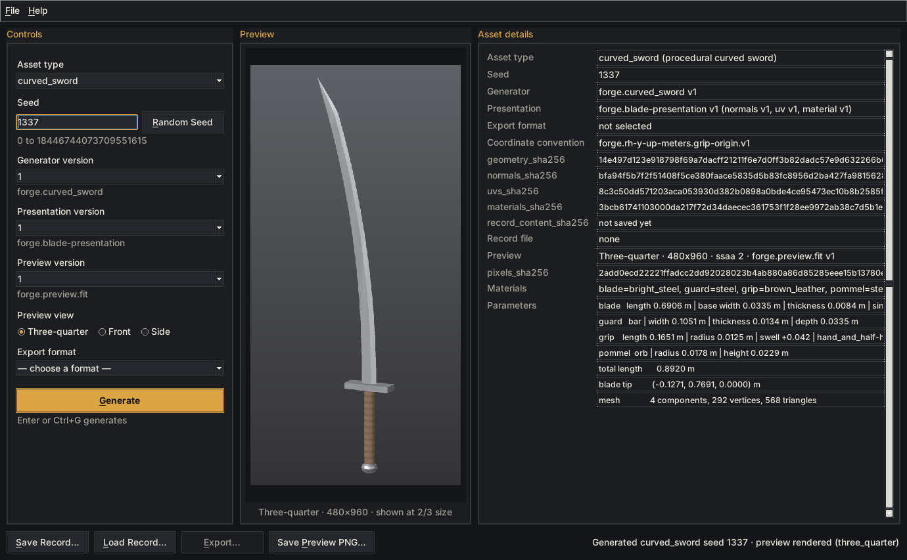
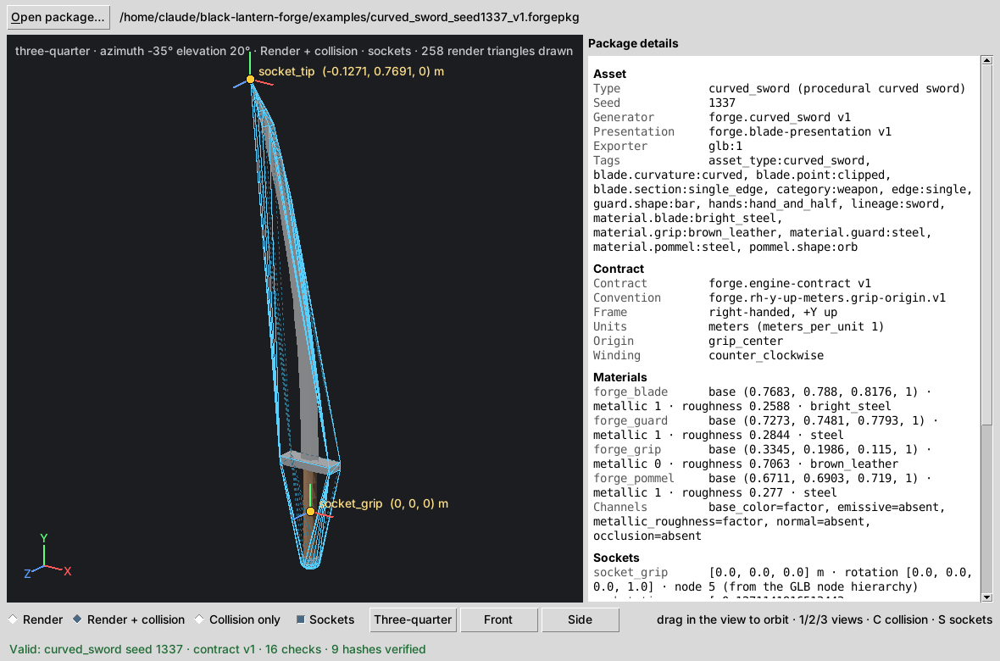
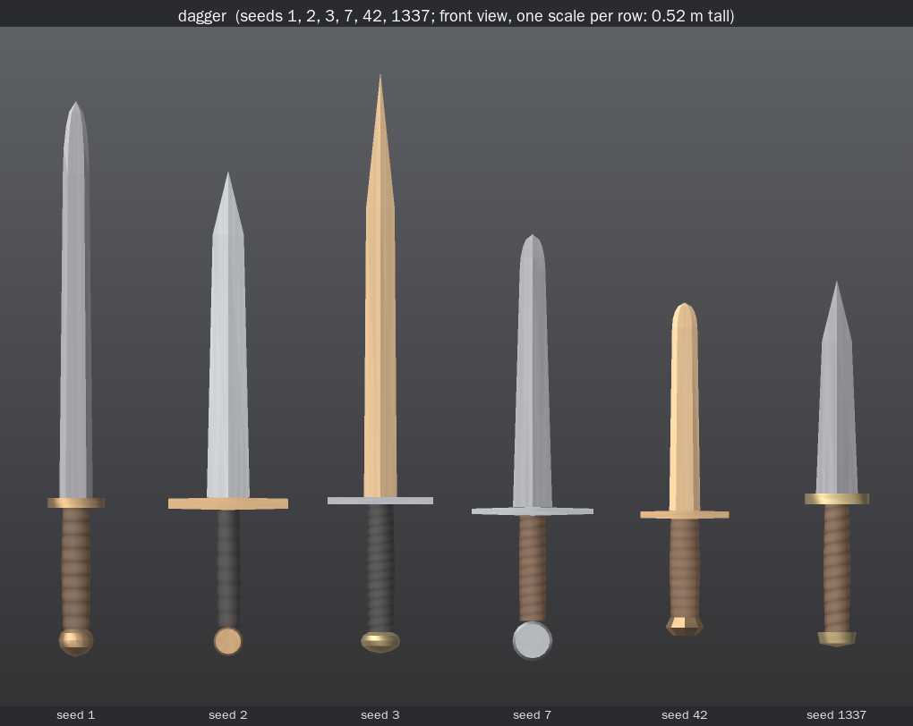
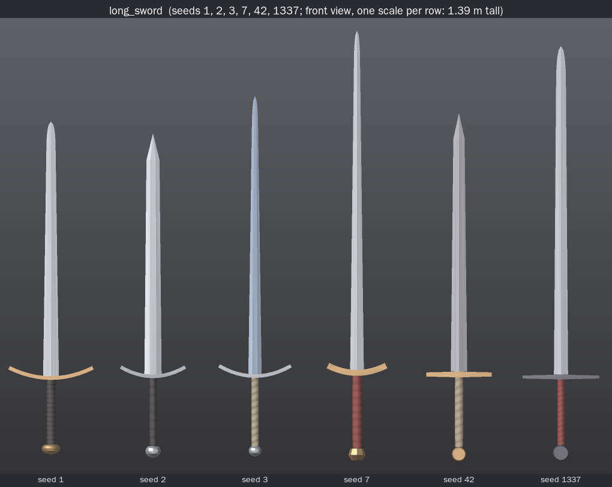
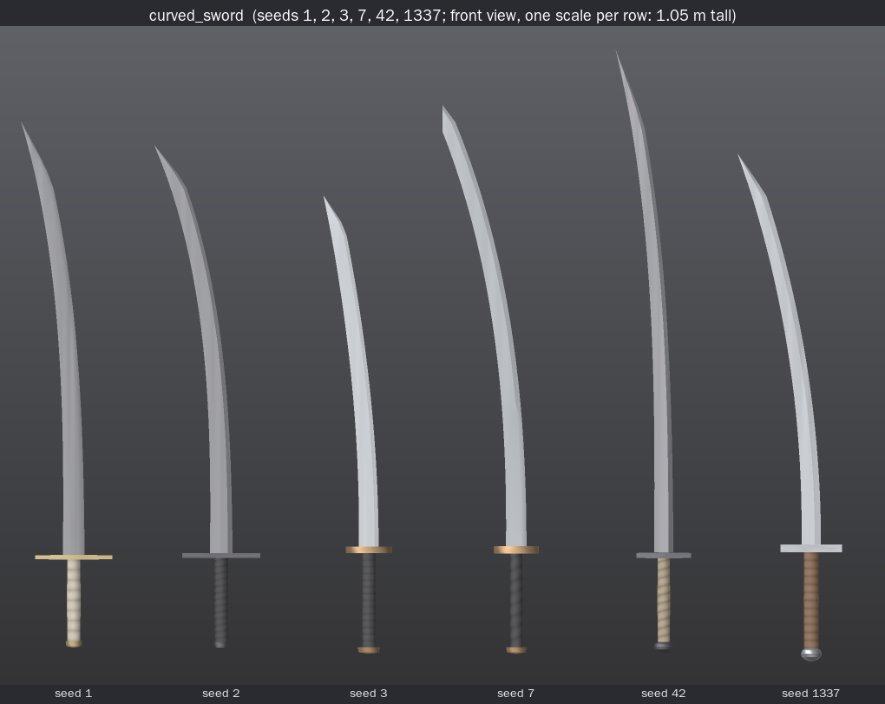
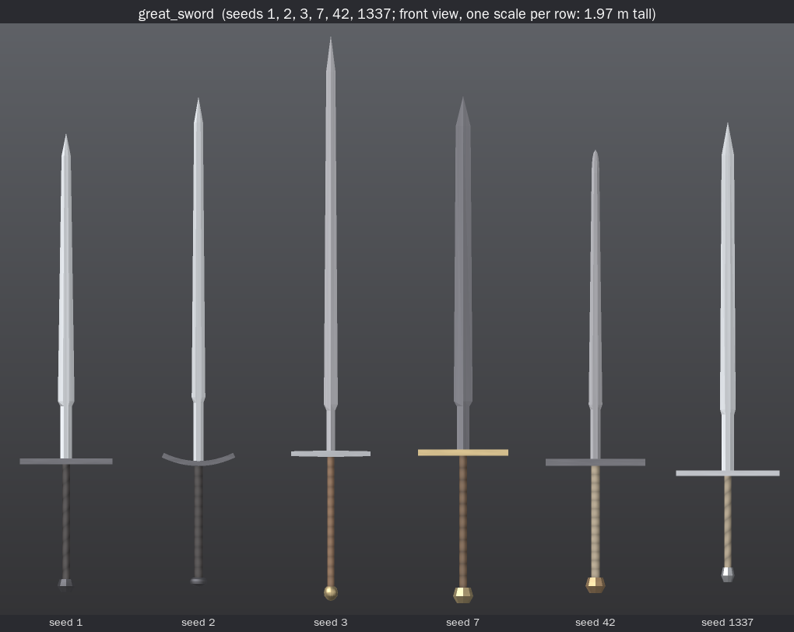

# First Arsenal: Blades (Step 5A)

> Black Lantern Forge can deterministically generate, present, persist, preview, export, validate,
> and independently ingest multiple registered rigid blade weapon families without changing frozen
> short-sword behavior.

That is the whole claim. It does not cover axes, maces, hammers, spears, polearms, crossbows,
firearms, a working bayonet mount, gameplay, animation, rigs, flexible weapons, historical presets,
or any game engine.



## 1. What Step 5A adds

Four production families, each with its own explicit identity. Nothing resolves to "latest".

| asset_type | generator | presentation | preview | exports | hands |
|---|---|---|---|---|---|
| `dagger` | `forge.dagger` v1 | `forge.blade-presentation` v1 | `forge.preview.fit` v1 | `glb:1`, `obj:2` | one |
| `long_sword` | `forge.long_sword` v1 | `forge.blade-presentation` v1 | `forge.preview.fit` v1 | `glb:1`, `obj:2` | hand-and-a-half |
| `curved_sword` | `forge.curved_sword` v1 | `forge.blade-presentation` v1 | `forge.preview.fit` v1 | `glb:1`, `obj:2` | one or hand-and-a-half |
| `great_sword` | `forge.great_sword` v1 | `forge.blade-presentation` v1 | `forge.preview.fit` v1 | `glb:1`, `obj:2` | two |

`short_sword` is unchanged: `forge.sword` v1, `forge.presentation` v1, `forge.preview` v1, and
`obj:1`, `obj:2` and `glb:1`. Its frozen hashes (OBJ, record, preview, GLB, manifest) are
re-checked by tests 61–65.

```bash
python -m forge generate dagger --seed 1337 --generator-version 1 --presentation-version 1
python -m forge generate curved_sword --seed 7 --generator-version 1 --presentation-version 1 \
    --save output/c7.json --preview output/c7.png --export glb:1 --out output/c7.forgepkg
python -m forge load output/c7.json
python -m forge_engine_viewer output/c7.forgepkg --validate-only
python -m forge sword --seed 1337        # unchanged: the pinned short-sword alias
```

## 2. The architectural test

The brief asked whether generic infrastructure would need family branches. **It did not.**

These ran the four families end to end with **zero edits**:

- persistence: `forge/record.py`
- registry dispatch: `forge/registry.py`
- CLI routing: `forge/cli.py`
- hashing: `forge/hashing.py`
- the OBJ format 2 writer
- the GLB writer, package builder and validator: `forge/engine/*`
- the preview rasterizer: `forge/render/raster.py`
- Forge Desktop: `forge_desktop/*`
- the Step 4 viewer: `forge_engine_viewer/*`

`tests/arsenal_frozen_sources.json` pins the Step 4 SHA-256 of all 57 such files, and a test fails
if any byte changes. Another test parses every generic module and rejects any of the following:

- a family name or new identifier
- an import of the blade code
- a comparison against an asset-type literal

Existing product files that did change:

| File | Change |
|---|---|
| `forge/catalog.py` | Registration data only. It imports `forge.assets.blades`, appends its entries, and adds `forge.blade-presentation` v1 to the accept-lists of `obj:2` and `glb:1`. It also registers `forge.preview.fit` v1. A test checks that it contains no conditional on an asset type. |
| `forge/__init__.py` | `__version__` 0.3.0 → 0.5.0. This is informational: it appears only in a record's `info` block, which every hash excludes. |
| `pyproject.toml` | distribution version 0.4.0 → 0.5.0. |

Frozen pieces that are sword-specific were **worked around, not edited**:

| Frozen piece | Why it can't serve the blades | Step 5A answer |
|---|---|---|
| `forge.presentation` v1 | requires a `SwordAsset`; its tables are keyed for the sword | a new presentation family, `forge.blade-presentation` v1. It has its own id, not a v2 of the sword family. |
| `forge.preview` v1 | fixed 0.84 m framing, sized for the short sword | a new preview renderer, `forge.preview.fit` v1. It is generic: it frames from the geometry. |
| OBJ format 1 | requires a `SwordAsset` | not offered by the blade families. They export `obj:2`; `obj:1` is refused with a clear error. |
| `PresentedSword` container | sword-named, but structurally generic | reused as-is |

## 3. Blade-family architecture

```
forge/blades/                      (new; imports nothing from forge.sword, forge.assets or forge.catalog)
  shapes.py      shared geometry: profiles, centerlines, sweep, guards, grips, pommels
  model.py       one parameter model + FamilyRules (plausibility envelope) + BladeAsset
  draws.py       shared hilt and blade parameter draws: fixed stream order, every value drawn
  build.py       params -> validated components + landmarks (blade_tip, grip_center, ...)
  dagger.py, long_sword.py, curved_sword.py, great_sword.py
                 per family: RULES, STREAM_LABELS, draw_params(seed), generate(seed)
  presentation.py  forge.blade-presentation v1: normals, UVs, materials
  lineage.py     blade classes (lineage, edge, hands) + bayonet groundwork
forge/assets/blades.py    registry entries, integrity functions, engine adapters (sockets, tags)
forge/render/fit.py       forge.preview.fit v1 (geometry-bound framing, frozen rasterizer)
```

Flow for every family, all through the registry:

```
seed ─▶ family.draw_params(seed)        isolated PCG32 stream per component
     ─▶ model.validate(params, RULES)   fail closed: nothing clamped or repaired
     ─▶ build.build_asset(...)          blade | guard | grip | pommel, every shell checked closed and outward
     ─▶ BladeAsset (immutable; components + params + landmarks)
     ─▶ derive_blade_presentation      PresentedSword container (the frozen generic one)
     ─▶ record / preview / obj:2 / glb:1 / validate / viewer: all unchanged generic code
```

`BladeAsset` exposes the same interface the generic code already reads:

- `asset_type`, `generator`, `generator_version`, `seed`
- `components` (a tuple of frozen `Mesh`)
- `component_names`, `bounds()` and `to_dict()`

It adds `params` and sorted `landmarks`.

## 4. Shared primitives (`forge/blades/shapes.py`)

The module uses only `+ - * /` and `sqrt`. There is no trigonometry, no `**`, no `pow()` and no
`sum()`, and a source-guard test enforces this. Every mesh it builds passes
`check_closed_oriented`; the tests also check each mesh with a second, independent checker.

**Cross-section profiles** (unit space, x across the edges, z across the flats):

- `DIAMOND`: the frozen 4-point ring
- `flat_hex(f)`: a fullered, flat-sided hexagon
- `single_edge(f)`: an edge at +x, with a flat spine of full thickness at −x

**Centerlines:**

- `straight_centerline(base_y, length, s_values)`
- `curved_centerline(...)`: see §6
- `parabolic_centerline(...)`: used for recurved quillons

**Sweep.** `sweep(name, profile, rings, start, end)` builds a closed shell through rings. Each ring
has a center C, an in-plane unit tangent T, a normal N = (T.y, −T.x, 0) and the world Z axis. The
frame (N, T, Z) is right-handed, like (X, Y, Z) in the frozen loft, so the frozen loft's
triangulation stays outward-facing. A per-ring `offset` shifts the profile along N; a clipped
point uses it to keep its spine straight. The `end` cap point becomes the blade's **apex vertex**.

**Point shapes.** Width factors over the point region, where q runs 0 to 1 from the shoulder to the apex:

| Shape | Width factor |
|---|---|
| `spear`, `acute`, `clipped` | 1 − q |
| `ogive` | √(1 − q²) |
| `leaf` | (1 − q)(1 + 4·bulge·q(1 − q)) |

**Guards:**

- `guard_bar`: covers both `bar` and `tapered`
- `guard_recurved`: quillons curve toward the blade; flat at the center, where blade and grip meet
- `guard_disc`: an oval plate

**Grip.** `grip`: octagonal and centered on the origin, with swell or waist and flattening.

**Pommels.** `pommel(shape, ...)`:

- `wheel`: a disc on the Z axis, rotated exactly with no trigonometry
- `orb`
- `faceted`
- `cap`

**Layout** follows the frozen convention exactly: grip centered on the origin, guard on the grip's top,
blade base on the guard's top, pommel hanging from the grip's bottom.

**Contacts.** Tests check that the parts touch, over 66 seeds per family. Along the central axis,
blade↔guard, guard↔grip and grip↔pommel meet within 1e-12 m (only floating rounding of the
shared plane). Each contact face lies inside the guard's footprint. A negative test confirms the
check catches a 1 mm gap.

## 5. Parameter model and plausibility (`model.py`)

One `BladeWeaponParams` holds the four component geometries:

| Component | Fields |
|---|---|
| `BladeGeom` | length, base_width, thickness, taper, distal_taper, cross_section, flat_fraction, point_shape, point_length_ratio, leaf_bulge, ricasso_length, ricasso_width_ratio, sagitta_ratio, curve_bias |
| `GuardGeom` | shape, width, thickness, depth, end_scale, rise |
| `GripGeom` | length, radius, swell, flatten, segments |
| `PommelGeom` | shape, radius, height, thickness |

Fields a family doesn't use must hold neutral values; validation insists on them. For example, a
straight family may not carry curvature, and only the great sword may have a ricasso.

`validate(params, FamilyRules)` raises `GenerationError` when:

- a value is out of range
- a proportion is out of range: blade width/length, thickness/width, guard/blade width, guard
  depth/blade thickness, grip diameter/guard depth, pommel/grip radius, grip/blade length
- the total length is out of range
- the blade base or grip would overhang the guard
- a diamond section has flats
- a leaf bulge appears on a non-leaf point
- a wheel pommel's height isn't its diameter
- a grip length doesn't afford the family's handedness

Every draw range lies inside its rule range, so all 3,000 seeds swept per family generate. A
seed that broke a rule would be refused, never repaired.

## 6. The families

Each family draws from **isolated PCG32 streams**: one per component (`forge.<family>.blade`,
`.guard`, `.grip`, `.pommel`), plus `forge.great_sword.ricasso` and `forge.curved_sword.curvature`.
Every helper draws every value unconditionally, in a fixed order, so the stream position never
depends on an earlier choice. Test 15 changes one stream at a time and checks that every other
stream's draws are bit-identical.

Ranges measured from the generated geometry over seeds 1–300 (meters):

| | dagger | long_sword | curved_sword | great_sword |
|---|---|---|---|---|
| blade length | 0.180–0.399 | 0.754–1.100 | 0.60–0.90 (arc) | 1.000–1.449 |
| tip height above guard | same | same | 0.58–0.88 (chord) | same |
| overall length | 0.29–0.55 | 1.01–1.40 | 0.72–1.15 | 1.40–1.97 |
| grip length | 0.085–0.115 | 0.19–0.25 | 0.11–0.25 | 0.30–0.46 |
| guard width | 0.034–0.148 | 0.14–0.32 | 0.056–0.141 | 0.225–0.465 |
| cross sections | diamond, hex | diamond, hex | single_edge | diamond, hex |
| points | spear, acute, ogive, leaf | spear, acute, ogive | clipped | spear, acute, ogive |
| guards | bar, tapered, recurved, disc | bar, tapered, recurved | bar, tapered, disc | bar, tapered, recurved |
| pommels | wheel, orb, faceted, cap | wheel, orb, faceted | cap, orb | wheel, orb, faceted |

- **dagger.** A compact one-handed blade, 0.18–0.40 m. Four point shapes, including a bulged leaf.
  Hilt shapes vary the most of any family. It is the parent of the bayonet lineage (§10).
- **long_sword.** A long, slender blade on a hand-and-a-half grip, 0.19–0.25 m. Generation refuses a
  grip long enough to count as two-handed. Wide cross guards (3.4–5.6× the blade width), often
  recurved, and heavy wheel, orb or faceted pommels.
- **curved_sword.** A single-edged, progressively curved blade (§7) with a clipped point, a
  compact guard (bar, tapered or disc) and a cap or orb pommel. Its grip is one-handed or
  hand-and-a-half.
- **great_sword.** A 1.0–1.45 m blade on a two-handed grip (0.30–0.46 m). A ricasso, the narrower
  unsharpened base section at 55–80% width, flares to full width over 1.5% of the blade.
  Very wide cross guards, 4.4–7× the blade width. Overall length stays under 2 m: 1.36–1.99 m
  over 3,000 seeds, and the rules refuse anything outside 1.33–2.10 m. Nothing is cartoon-sized.

## 7. Curvature: real, progressive, deterministic, trig-free

The curved blade's centerline is 24 equal arc-length segments. Each turns relative to the last by
a rational (Cayley) rotation:

```
cos = (1 − t²) / (1 + t²)      sin = 2t / (1 + t²)      t = scale · w(s)
w(s) = 1 + bias · (2s − 1)     s = (j + 1) / 24
```

The rotation is exact for the parameter t: nothing is approximated, and nothing depends on a libm.

**Bias** sets where the curve is concentrated:

- above 0, it tightens toward the tip
- below 0, it eases toward the tip

**Scale** is found by doubling a bracket, then 60 bisection steps, so the sagitta equals
`sagitta_ratio · length`. The sagitta is the largest distance of the centerline from its chord;
`sagitta_ratio` is drawn in 1.5–6%.

**Sweep.** The body sweeps along the curve, with every ring perpendicular to the local tangent.
It is not a straight blade rotated, and not one with only the tip bent. The blade:

- bends toward −X
- carries its edge on the convex +X side
- leaves the guard vertically
- never turns past an end-tangent y of 0.80, about 37°

Test 20 checks all of this on the generated mesh, over 66 seeds:

- each ring lies across its tangent within 1e-12
- segments have equal length
- every turn goes the same way
- turn increments are monotonic with the bias
- the drawn sagitta is reached within 1e-9 m
- the tip sits off the axis

**The terminal point.** A clipped point keeps its spine straight, so the apex sits on the spine
line, off the centerline. The generator records the apex vertex as the `blade_tip` landmark, and
`socket_tip` uses that landmark. It never takes "the vertex with the greatest y".

Test 45b builds a blade from the same primitives that curls past the generator's limit. Its
highest vertex sits 5+ mm above its terminal point, and the adapter still places `socket_tip` at
the terminal point.

## 8. Presentation: `forge.blade-presentation` v1

This is a new presentation family, not a new version of the frozen `forge.presentation`. It pins
normals 1, uv 1 and material 1, and outputs the frozen `PresentedSword` container: face-varying
normals and UVs, plus one frozen `Material` per component. Records, previews, `obj:2` and `glb:1`
therefore consume it unchanged.

**Normals** use the same face-normal and crease rules as the frozen v1, with a per-family mode table.

| Component | Mode |
|---|---|
| blade, straight families | faceted (crisp ridges and bevels, like the short sword) |
| blade, curved sword | crease cos 0.94 (≈20°): smooth along the curve, hard at the spine and edge bevel |
| guard | crease 30° |
| grip | crease 60° |
| pommel | crease 30° |

**UVs** use the same box and cylindrical projections as the frozen v1:

| Component | Projection |
|---|---|
| blade, guard | box |
| grip | cylindrical |
| pommel | cylindrical; box for a wheel pommel, whose axis is Z |

All values are in [0, 1]. On a curved blade, the box projection maps the flats orthographically,
so the curve adds no distortion.

**Materials** are the frozen `Material`, `BrushedPattern`, `PatinaPattern` and `WrapPattern`
classes, drawn from per-family palettes in the same draw order as the frozen v1:

| Family | Blade options | Grip options |
|---|---|---|
| dagger | steels, bronze | leather, wood, horn |
| long_sword | steels, blued steel | leather, cord |
| curved_sword | steels, polished steel | cord, black cord, leather, pale wrap |
| great_sword | steels, blackened steel | leather, wood, cord |

Each component has its own stream, `forge.blade-presentation.material.v1.<family>.<component>`,
so materials can never shift geometry.

## 9. Preview: `forge.preview.fit` v1

Frozen preview v1 frames a fixed 0.84 m window. A dagger would be tiny in it, and a great sword
clipped. `forge.preview.fit` v1 reuses everything else unchanged: the view bases, the rasterizer,
the shading, and the PNG and metadata. It changes only the framing:

- **Extents.** Every vertex is projected onto the view's right and up axes.
- **Target.** The center of those extents, at zero depth along the view direction.
- **Frame.** `half_height = max(span_up/2, span_right/2 · H/W) · 1.06`.

It uses only `+ - * /` and comparisons, so the framing is as deterministic as the geometry. The
camera is embedded in the PNG metadata, as before. The short sword keeps `forge.preview` v1, so
its pixels can't change; test 63 pins them.

`PreviewSettings` still accepts only `preview_version` 1, and a frozen Step 2 test pins that. A
new preview *id* fits the existing schema without touching it, where a v2 of `forge.preview`
would not.

## 10. Sockets, collision, Contract v1

**Contract v1 can represent every family, so no Contract v2 was made.**

| Item | Derivation |
|---|---|
| `socket_grip` | `[0, 0, 0]`, identity rotation. The adapter checks that the grip's bounding-box center is within 1e-9 m of the origin. |
| `socket_tip` | the recorded blade apex (`blade_tip` landmark), rounded to binary32, identity rotation. The adapter refuses a landmark that isn't a blade vertex. |
| `collision_hull` | the frozen exact-integer convex hull of every LOD0 render vertex |
| tags | `asset_type`, `category:weapon`, `lineage`, `edge`, `hands` (from the actual grip), `blade.curvature`, `blade.section`, `blade.point`, `guard.shape`, `pommel.shape`, `material.<component>` |

**How the contract accommodates the new derivation.** FORGE_ENGINE_CONTRACT_V1.md §8 describes
the short sword's `socket_tip` as "the unique blade vertex with the greatest y". That is the short
sword adapter's rule, and it stays true for the short sword. The contract's machine-checked socket
rules are different: required names, the `socket_` prefix, the parent, matching manifest and GLB
transforms, `socket_grip` at the origin, and a non-empty declared `derivation`. Both the Forge
validator and the independent viewer enforce exactly those rules. The blade families declare their
own derivation (the terminal point). The frozen contract document was not edited.

**Limitation.** The Forge package builder (frozen, generic) allows only identity socket rotations
under Contract v1. A curved blade's `socket_tip` therefore says where the tip is, not which way it
points. The tip direction exists Forge-side, as the `blade_tip_tangent` landmark, but isn't
exported. Carrying it would need an oriented socket, which is a contract-level decision deferred
past Step 5A.

## 11. Persistence, packages, viewer, desktop

- **Records.** The generic Step 2 schema, unchanged. Integrity is `geometry_sha256`,
  `normals_sha256`, `uvs_sha256` and `materials_sha256`, plus `record_content_sha256`; there is no
  `obj_format1_sha256`. `forge load` verifies 6 checks. A registry without a family refuses that
  family's records with `UnknownAssetTypeError`.
- **Engine packages.** `glb:1` through the unchanged writer. The same identity gives
  byte-identical `asset.glb` and `manifest.json` across processes and hash seeds (test 58). All
  four goldens pass the Khronos glTF validator with 0 errors and 0 warnings.
- **Viewer.** The Step 4 `forge_engine_viewer` ingests all four families with no family code. Its
  11 source files are byte-identical to Step 4, import nothing from `forge`, and name no asset
  family. A fresh-process test copies only the viewer and the four golden packages into an empty
  directory, so Forge can't be imported. It then validates them and dumps their sockets.
- **Desktop.** Forge Desktop lists `curved_sword, dagger, great_sword, long_sword, short_sword`
  from the registry. With several types it preselects none, per its Step 2.75 rule. Each family's
  single generator, presentation and preview version is preselected. With two exporters,
  `glb:1` and `obj:2`, the user picks. Generate, every view, save, load, preview save, OBJ and
  engine-package export all work per family (test 56, plus a real-window test under Tk).





## 12. Bayonet lineage (architecture only)

`forge/blades/lineage.py` records that a future bayonet belongs to the **blade lineage**, closest
to the dagger. It is not a firearm architecture. Concretely:

- **`BladeClass`.** Each family has one: lineage (`short_blade` or `sword`), edge, the hands it
  affords, attachment roles, and whether it is the bayonet lineage parent. Only `dagger` is.
- **`BAYONET_LINEAGE`.** Status `experimental`, parent `dagger`. **Not registered:** no
  generator, no asset type, no package.
- **`MountSpec`.** Mount type `socket`, `plug` or `lug`, with bore, ring and offset dimensions in
  meters. It validates and fails closed, but nothing generates or exports it.
- **Reserved socket names.** `socket_mount` (bayonet side) and `socket_muzzle` (a future firearm
  side). Both fit Contract v1's `socket_*` rule, so no contract change would be needed. No Step 5A
  package carries either; a test asserts that.

Deferred: firearm sockets, mounting to pistols or rifles, dynamic attachment composition.

## 13. Golden fixtures (seed 1337)

All goldens are in `examples/`, produced by the CLI command in
`examples/arsenal_seed1337.golden.json`. The record, preview, GLB and manifest bytes are re-checked
byte for byte by tests 58–60. Previews are three-quarter, 480×960, 2×2 supersampling.

| | dagger | long_sword | curved_sword | great_sword |
|---|---|---|---|---|
| geometry_sha256 | `174bd33b…22e8` | `c4596377…2dbb` | `14e497d1…6d76` | `8e2cc76b…3ab8` |
| record_content_sha256 | `2de2913b…847c` | `25937b7a…b258` | `16ae5dad…964c` | `2843870a…42ff` |
| preview pixels_sha256 | `5e4766b7…9fe8` | `3a0cea7e…7884` | `2add0ecd…fcc1` | `b11643ca…2615` |
| asset.glb sha256 | `bef7e755…1c7c` | `3b16e4f8…fadf` | `d321ecbb…1fca` | `302c04f5…6051` |
| manifest.json sha256 | `d73a6f37…9504` | `b9f6d5a3…9d16` | `5543121f…a722` | `08ca3798…7f1b` |
| socket_tip | (0, 0.25501546, 0) | (0, 1.18428993, 0) | (−0.12711419, 0.76905495, 0) | (0, 1.38972628, 0) |
| collision hull | 68 v / 132 t | 55 v / 106 t | 85 v / 166 t | 25 v / 46 t |
| source mesh | 104 v / 192 t | 168 v / 320 t | 292 v / 568 t | 124 v / 232 t |

The full 64-character values are in `examples/arsenal_seed1337.golden.json`.

## 14. Visual lineups

Seeds 1, 2, 3, 7, 42 and 1337, front view, one fixed scale per family. The lineups make it
possible to judge silhouette, proportion, variation, and any obvious geometry failure. The
arsenal image at the top puts all five types at one common scale.






## 15. Tests

There are 112 new tests in 8 files. Brief numbers map to files as follows:

| File | Brief tests | Also covers |
|---|---|---|
| `test_arsenal_families.py` | 1–6, 29 | CLI, lineage and bayonet checks |
| `test_arsenal_geometry.py` | 7–28 | contacts, plausibility guards, source guard |
| `test_arsenal_presentation.py` | 30–36, 57, 60 | fit framing |
| `test_arsenal_persistence.py` | 37, 38, 59 | golden records, fail-closed cases |
| `test_arsenal_engine.py` | 39–49, 58 | 45b, golden packages |
| `test_arsenal_viewer.py` | 50–54 | Forge-absent ingestion |
| `test_arsenal_desktop.py` | 55, 56 | real window |
| `test_arsenal_frozen.py` | 61–71 | architecture tests |

Tests 66–71 re-run each earlier step's suite in a fresh interpreter at its frozen count:

| Step | Tests |
|---|---|
| 4 | 94 |
| 3 | 84 |
| 2.75 | 49 |
| 2.5 | 44 |
| 2 | 77 |
| 1 | 68 |

### Disclosed edits to frozen test files

Registering four more asset types broke assertions that pinned the catalog to one type, and
desktop tests that relied on the single-type preselection. These were fixed with minimal edits;
no frozen product behavior changed:

| File | Edit |
|---|---|
| `tests/registry_fixtures.py` | `spying_registry` now wraps only the production short_sword entries (`assets=t["assets"][:1]`), matching the one generator and presentation it already took. Docstring updated. |
| `tests/desktop_support.py` | `make_session` selects `short_sword` when nothing is preselected (4 lines). |
| `tests/test_registry_core.py` | the expected `asset_types()` tuple lists five types; the `obj:2` accept-list includes `forge.blade-presentation` v1 |
| `tests/test_registry_family.py` | the expected production `asset_types()` lists five types, plus `test_tetra` |
| `tests/test_desktop_session.py` | the expected asset-type list is five types; one comment |
| `tests/test_engine_export.py` | the `glb:1` accept-list includes `forge.blade-presentation` v1 |
| `tests/test_engine_integration.py` | the Step 3 real-window test selects `short_sword` first (1 line) |

Test counts are unchanged in every frozen file.

## 16. Known limitations

- **Geometry.**
  - Simple swept and lofted shapes, low-poly by design.
  - Components are separate closed shells that touch; they aren't welded.
  - No fullers cut into the blade, no ricasso notches, no langets or side rings, no scabbards.
- **Curvature.**
  - In-plane only: no twist, and no curvature out of the XY plane.
  - The curved blade's end tangent is capped at y ≥ 0.80. A tighter curl, such as a full
    shamshir, would need a new generator version.
- **Sockets** carry identity rotations (§10). The curved tip's direction isn't exported.
- **Presentation.**
  - The straight blades are flat-shaded.
  - UVs are simple projections.
  - No textures are baked; packages carry PBR factors only, as in Step 3.
- **Historical accuracy.** Proportions are plausible, not historical presets. The families are
  broad envelopes, not named types.
- **Platforms.**
  - Byte stability was verified on CPython 3.10–3.13 on x86-64 Linux only.
  - The desktop was tested under a virtual X display only.

## 17. Deferred (explicitly NOT in Step 5A)

| Area | Deferred |
|---|---|
| Weapons | axes, maces, hammers, spears, polearms, crossbows, firearms |
| Bayonet | any working mount, `socket_mount` / `socket_muzzle` in packages, dynamic attachment |
| Gameplay and motion | gameplay stats, animation, rigs, flexible weapons |
| Content | historical presets |
| Engines | Unreal / Unity / Godot integration |
| Platform | Black Lantern OS |
| Contract | oriented sockets, a Contract v2, LOD1+, multi-hull collision, baked textures |
