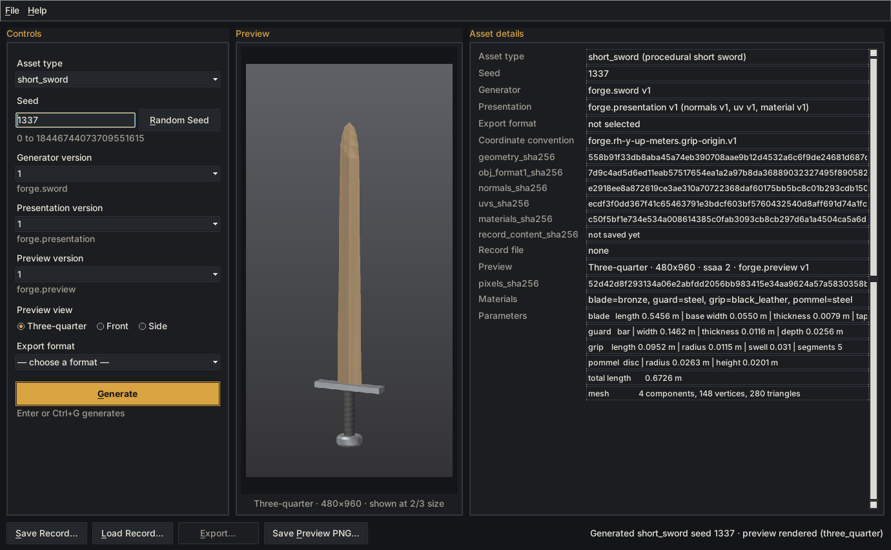
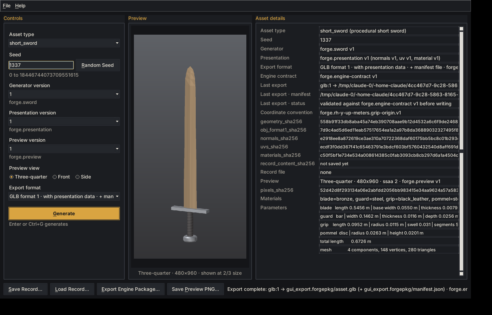
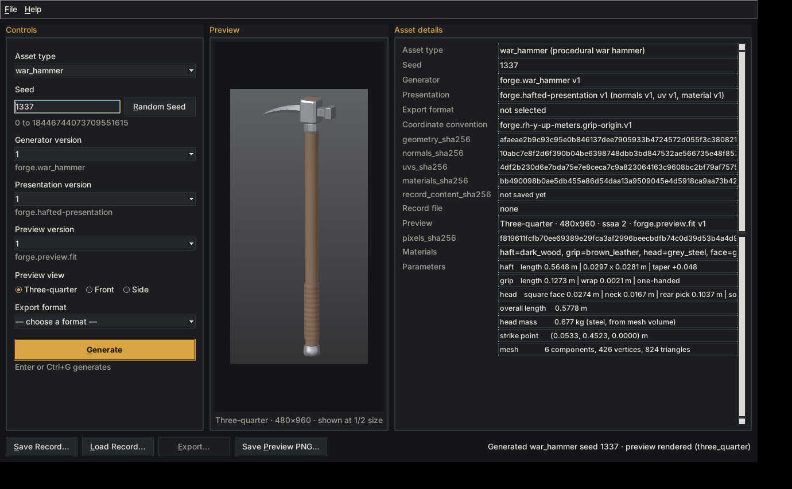
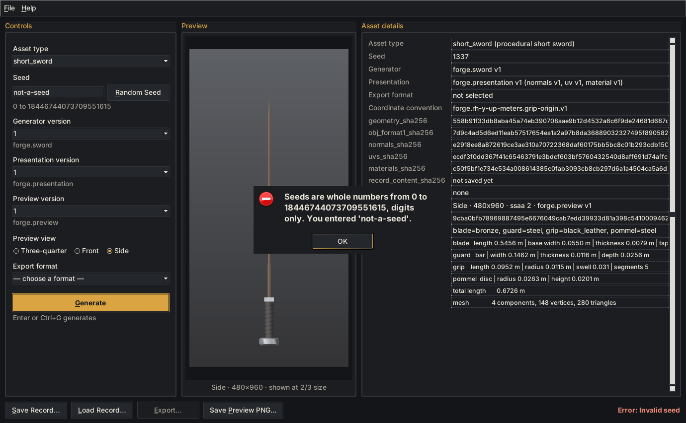

# Forge Desktop (Step 2.75 — FIRST FACE)

> Black Lantern Forge can be launched as a local desktop application that uses
> the frozen registry-driven pipeline to generate, preview, save, load, and
> export supported assets without changing frozen asset behavior.



## Launch

From the repository root:

```bash
python -m forge_desktop        # the desktop app
python -m forge.gui            # same thing (a one-line launcher in the core namespace)
```

There's also a double-click launcher, `launch_forge_desktop.pyw`. On Windows it
runs without a console window. After `pip install .`, the `forge-desktop` command
is installed too, as a GUI entry point.

`python -m forge_desktop --check` builds the window, processes events once, and
exits. It's a quick check that Tk and a display are available.

**Requirements:** Python 3.10+ with **Tkinter**, the only GUI toolkit, which ships
with Python. No other dependencies.

- **Windows / macOS:** the python.org installers include Tkinter.
- **Debian / Ubuntu:** `sudo apt install python3-tk`
- **Fedora:** `sudo dnf install python3-tkinter`

If Tkinter or a display is missing, the app says so in plain words and exits
with code 1. The CLI (`python -m forge`) never needs Tkinter.

## Layout

| Area | Contents |
|---|---|
| **Controls** (left) | Asset type · Seed + **Random Seed** · Generator version · Presentation version · Preview version · Preview view (Three-quarter / Front / Side) · Export format · **Generate** |
| **Preview** (center) | The rendered preview, scaled to fit the window. The caption shows the view, the true render size, and the display scale. |
| **Asset details** (right) | Asset type, seed, generator id/version, presentation versions, export format, coordinate convention, every integrity hash (`geometry_sha256`, `obj_format1_sha256`, `normals_sha256`, `uvs_sha256`, `materials_sha256`), `record_content_sha256` once saved or loaded, record file, preview settings, `pixels_sha256`, materials, parameters. Values are read-only fields you can select and copy. |
| **Action bar** (bottom) | **Save Record…** · **Load Record…** · **Export…** · **Save Preview PNG…** · status line |
| **Menu** | File: Load / Save Record, an **Export** submenu built from the registry, Save Preview PNG, Quit. Help: About. |


## Generate flow

Pressing **Generate** (or Enter in the seed field, or Ctrl+G) runs these steps:

1. Validate the selected asset type against the asset registry.
2. Validate the seed. Surrounding whitespace in the field is ignored; otherwise
   the core seed policy applies.
3. Resolve the **exact** generator version: `registry.generator(id, version)`.
4. Generate through the registry: `generate_asset`.
5. Derive presentation through the registry, using the explicit presentation
   version: `present_asset`.
6. Render the preview through the registry, using the explicit preview version and
   view: `render_asset_preview`.
7. Fill in the details panel.
8. Enable the actions that are valid now. Export also needs a chosen format.

Generation and rendering run on a background thread, so the window stays
responsive. While it's busy, the actions are disabled, a progress bar runs, and
the status line says what's happening. Results are applied on the UI thread.

## Preview views

The view buttons switch between **Three-quarter**, **Front** and **Side**. Each
view is rendered once per asset and then cached, so switching back is instant.
Switching views never regenerates or changes geometry; a test checks the generator
isn't called again.

- **Renderer:** the existing Step 2 software renderer. No new renderer was built.
- **Size:** the GUI renders at the frozen default settings (480×960, 2×2
  supersampling), so its previews and saved PNGs match the CLI's bit for bit.
- **Display scaling:** to fit the window, the image is scaled down for *display
  only*: 3/4, 2/3 or 1/2, using Tk's integer zoom/subsample. Saved PNGs, hashes
  and records are never scaled.
- **No image library:** pixels reach Tk as an in-memory binary PPM, which both
  Tk 8.6 and Tk 9.0 decode natively.

## Save, Load, Export, Save Preview

| Action | What it does |
|---|---|
| **Save Record…** | Writes a standard Step 2 asset record through `forge.record` (not a GUI-only format). It includes the current view's preview settings and pixel hash. The CLI loads it: `python -m forge load` / `preview`. Saving twice without changes gives byte-identical files. |
| **Load Record…** | Validates, resolves registries, regenerates, and verifies every integrity hash (`forge.record.load_record`). It then restores the record's **exact** asset type, seed and versions in the selectors and re-renders the preview with the record's settings. If the record stores a pixel hash, the details show `(matches record)`. A mismatch opens a warning. Malformed, unknown-type or tampered records open an error dialog, and the current asset stays on screen. |
| **Export…** | Exports in the selected format. The choices are exactly the asset type's registered `export_formats`, today `glb:1`, `obj:1` and `obj:2`. Unsupported formats never appear. `obj:2` also writes the `.mtl`. |
| **Export Engine Package…** | The same button, relabelled when the selected exporter declares an engine contract in the registry (Step 3: `glb:1`). It writes a `.forgepkg` directory holding `asset.glb` + `manifest.json`, validated against the contract before anything is written. Details then show **Engine contract** (`forge.engine-contract v1`) and **Last export** rows: the GLB path, the manifest path, and the validation status. See [FORGE_ENGINE_CONTRACT_V1.md](FORGE_ENGINE_CONTRACT_V1.md). |
| **Save Preview PNG…** | Saves the displayed view at full render size, with the deterministic `forge.preview` metadata chunk. |



File dialogs are native (`tkinter.filedialog`). The app remembers the last folder
for the current run only; nothing is written to disk.

## Registry-driven behavior

The GUI hard-codes no asset type, version or format:

| Control | Source |
|---|---|
| Asset type list | `registry.asset_types()` |
| Generator versions | `registry.generator_versions(descriptor.generator_id)` |
| Presentation versions | `registry.presentation_versions(descriptor.presentation_id)` |
| Preview versions | registered renderer versions that the selected presentation declares compatible |
| Views | the preview capability (none if the asset type has no `preview_id`) |
| Export formats | `descriptor.export_formats`, resolved through the export registry |
| Engine package label + contract | `ExportEntry.contract` of the resolved exporter (Step 3); the shell never names GLB |

**No implicit latest.** A selector is preselected only when exactly one choice
exists, and its version number is always shown. With several versions, the field
starts empty and Generate refuses until you choose. A test registers a pretend
generator v2 to prove this. Export formats are never preselected when more than
one exists.

**Step 5A: several asset types.** The registry now lists five asset types:
`curved_sword`, `dagger`, `great_sword`, `long_sword` and `short_sword`, sorted like every registry
listing. By the same rule, the Asset type field therefore starts empty, and Generate asks you to
choose one. Each blade family registers one generator, one presentation and one preview version,
so once a family is chosen those are preselected. It offers two exporters (`glb:1`, `obj:2`), so
the export format stays unselected until you pick one. The preview uses the family's registered
renderer (`forge.preview.fit` v1, which frames the whole weapon). No shell code changed: the list,
the options and the labels all come from the registry.

**Step 5B: hafted families.** The registry now lists nine asset types: the five above plus
`mace`, `one_hand_axe`, `two_hand_axe` and `war_hammer`, sorted. They behave exactly like the
blade families: one generator, one presentation and one preview version each (preselected once
the family is chosen), and `glb:1` / `obj:2` with neither preselected. The shell's code is
byte-identical to Step 4 and names no family; a test checks that, and another drives a real
window through every hafted family.



**Random Seed** picks a seed from the OS random source (`secrets.randbits(64)`)
and puts it in the seed field. It's a convenience only. The seed is then explicit
and visible, and generation stays deterministic. Clicking it doesn't generate.

## Errors and status

- **The status line always says what happened.** For example: "Ready",
  "Generated short_sword seed 1337 · preview rendered (three_quarter)",
  "Record saved: …", "Export complete: obj:2 → … (+ ….mtl)",
  "Export complete: glb:1 → x.forgepkg/asset.glb (+ x.forgepkg/manifest.json) · forge.engine-contract v1 validated".
- **Failures are visible without relying on color.** The status line starts with
  **"Error:"** in bold, and a dialog explains in plain words.
- **The last good asset is kept.** On failure, the current asset stays on screen.
- **Unexpected errors don't crash the app.** You get a dialog naming the error
  type, and the full traceback goes to the log (stderr), not the dialog.



## Keyboard and accessibility

- **Every control is reachable with Tab,** in a sensible order: controls, then
  details, then actions. A test walks the focus chain.
- **Shortcuts:** Enter in the seed field or Ctrl+G to generate · Ctrl+R random
  seed · Ctrl+O load · Ctrl+S save · Ctrl+E export · Ctrl+P save preview · Ctrl+Q quit.
- **Mnemonics:** Alt + the underlined letter on each button.
- **Text, not icons.** All buttons have text labels, and the view buttons are
  labeled radio buttons.
- **State shows by shape too.** The selected radio shows an amber dot; disabled
  controls are greyed and not focusable as actions.
- **Readable theme:** dark, high-contrast, with a single amber accent.

## Shell vs core

```
 Tk widgets (window.py)  ──events──▶  DesktopSession (session.py)   window state + intents; headless
                         ◀─view model─         │
                                                ▼
                                    ForgeController (controller.py)  the only bridge to the core
                                                │  registry dispatch only
                                                ▼
            forge.registry · forge.record · forge.render settings/PNG   (frozen core, unchanged)
```

- **The shell is its own top-level package.** `forge_desktop` is separate from
  `forge`. That keeps the deterministic core free of GUI and entropy code: the
  frozen Step 1 tests forbid `random`, `secrets` and `time` anywhere in `forge/`.
  The core never imports the shell. `forge/gui.py` imports it only when run as a
  script.
- **The controller never names an asset family.** It doesn't import `forge.sword`,
  `forge.assets`, exporters or presentation code. Guard tests enforce this.
- **State lives in the shell.** `DesktopSession` holds only GUI state: selections,
  explicit versions, seed text, view, the current result, the record path and
  the status. Registries are never mutated; a test snapshots them.
- **Collaborators are injected.** File dialogs, the background runner and the
  random-seed source are passed in, so the session and controller run fully
  headless in tests.

## Testing

| File | Covers |
|---|---|
| `test_desktop_controller.py` | registry dispatch, explicit versions, previews matching the frozen goldens, save/load/export, CLI interop |
| `test_desktop_session.py` | launch behavior, preselection rules, busy state, error handling, file actions with scripted dialogs |
| `test_desktop_guards.py` | no registry bypass, no asset literals, no "latest", entropy confinement, headless layers, core/shell separation |
| `test_desktop_window.py` | real-window smoke test |

The real-window smoke test is **skipped automatically** when Tkinter or a display
is missing, so the suite never needs a graphical session.

## Known limitations

- **One window, one asset at a time.** No asset browser, no undo, no dockable panels.
- **Preview speed.** A 480×960 render takes about 2–3 s; it runs in the background.
- **Display scaling is coarse.** Integer ratios only, nearest-neighbor
  subsampling, and no special handling for HiDPI displays.
- **Long values can clip.** On narrow windows, long values (full hashes, paths)
  can be cut off in the details panel. Click the field and scroll, or copy.
- **Last folder isn't remembered between runs.**
- **Re-exporting an engine package to the same name.** A `.forgepkg` package is
  a directory. Native save dialogs may open an existing directory instead of
  selecting it. Pick a new name, or type the existing name from its parent
  folder.
- **Small differences with the CLI.** The GUI ignores surrounding whitespace in
  the seed field; the CLI doesn't.

## Platform notes

**Tested:** Linux/X11 under a virtual display (Xvfb), with Tk 8.6 (Python 3.12)
and Tk 9.0 (Python 3.10, 3.12, 3.13). That covers the full suite and a scripted
live session.

**Not tested:**

- Real Windows and macOS desktops. The code uses only portable Tk features, but
  that's argued, not verified.
- On macOS, the menu bar is native, so the dark menu colors won't apply.
- Font metrics differ per platform, so the layout may shift slightly.

## Packaging status

There's no standalone executable yet; that's a later milestone. Launch it with
Python (above), the `.pyw` launcher, or the `forge-desktop` entry point after
`pip install .`.

## Deferred

- **Distribution:** standalone EXE/app bundles.
- **Engines:** engine viewers and engine connectivity (Step 3 exports engine
  packages; it doesn't talk to an engine).
- **Tools:** node graphs and shader editors, asset browser database.
- **Platform:** plugins, networking.
- **Content:** a second production asset family.
- **UI:** final Black Lantern styling, dockable panels.
