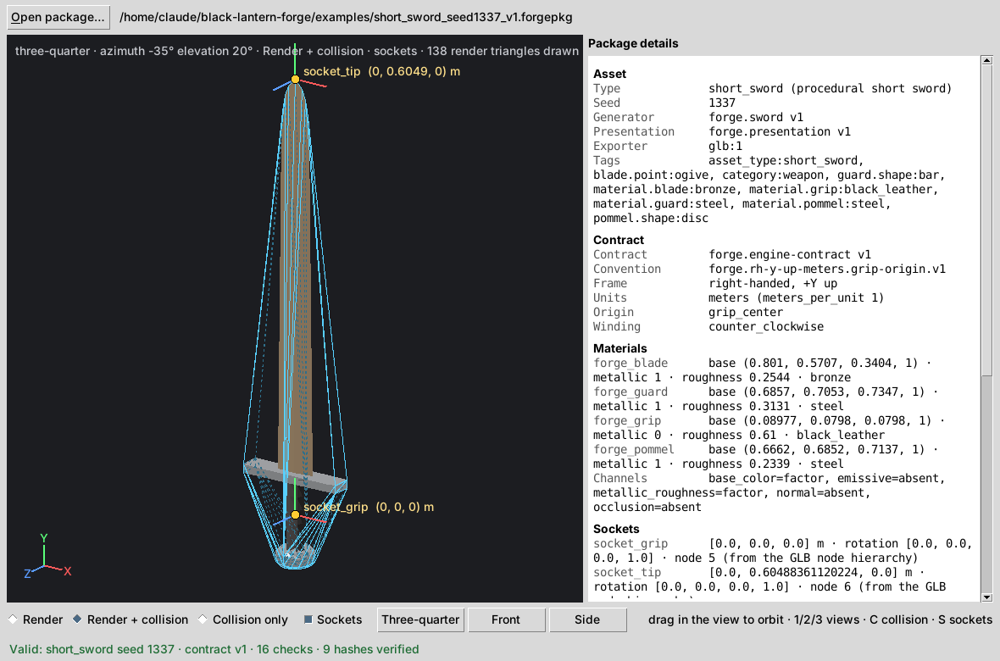
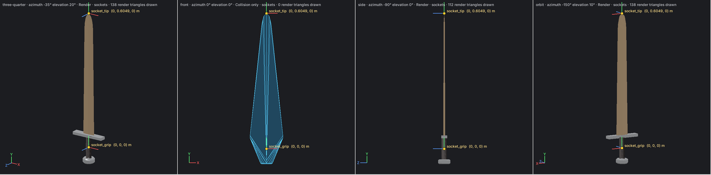

# First Ingestion (Step 4)

> An independent engine-side consumer can validate and ingest a Forge → Engine
> Contract v1 package, render its asset geometry, locate its declared sockets,
> and inspect its collision representation without using Forge generation code.



## 1. Purpose

Step 3 defined a package format. Step 4 is the first program on the *other side*
of that format: a small engine-side consumer that only has the files on disk.

The consumer is `forge_engine_viewer`. It shows that a `.forgepkg` directory can be:

- discovered
- validated
- parsed
- decoded
- rendered
- inspected for sockets
- inspected for collision
- interpreted per the contract

…without Forge's generator, PRNG, presentation code, preview renderer, GLB
writer, package writer or validator.

**What it is not:**

- It is not a game engine, an editor, or an Unreal, Unity or Godot importer.
- It never modifies or repairs a package.

## 2. Architecture

```
Forge (exports)                     consumer (reads)
───────────────                     ────────────────────────────────────────────────
forge.engine.package ─▶ PKG.forgepkg ─▶ forge_engine_viewer.ingest ─▶ IngestedPackage (immutable)
                        asset.glb                      │                        │
                        manifest.json                  ▼                        ▼
                                           glb.py (own GLB reader)   render.py (draw list, headless)
                                           contract_v1.py (own copy)  summary.py (text / JSON / details)
                                                                      session.py (state, headless)
                                                                      window.py (Tk canvas + panel)
                                                                      cli.py (--validate-only, --dump-summary)
```

| Module | Role |
|---|---|
| `contract_v1.py` | The viewer's own copy of the Contract v1 constants (§11) |
| `errors.py` | `IngestionError(code, message)`: the only exception ordinary bad input produces |
| `glb.py` | GLB header, chunks, strict JSON, buffers/bufferViews, bounds-checked accessor decoding |
| `ingest.py` | The load flow (§4) and the immutable model: meshes, materials, sockets, collision, LOD |
| `render.py` | Camera presets and orbit, the viewer-space transform, shading, overlays → a frame of 2D items |
| `summary.py` | Summaries for the CLI and the details panel (canonical values only) |
| `session.py` | What the window shows and when; no Tk, fully testable |
| `window.py` | The Tk window, the only module that imports `tkinter` |
| `cli.py`, `__main__.py` | Command line |

**Rendering approach.** It draws on a Tkinter `Canvas` in pure Python, with no
new dependency:

- numpy isn't available on the system Pythons, and Tk is already the project's
  GUI toolkit.
- The package has 280 render triangles and 94 collision triangles, so redraw
  and drag-to-orbit are instant.
- The renderer produces a headless *frame*, a list of polygons, lines, markers
  and text, so every view and overlay is tested without a display.

## 3. Package discovery

The consumer takes an explicit directory path and works from disk only.

**Contents.** The directory must hold exactly `asset.glb` and `manifest.json`,
and both must be files. Anything else is refused:

| Problem | Error code |
|---|---|
| a missing manifest | `missing_manifest` |
| a missing GLB | `missing_glb` |
| an extra entry | `unexpected_entry` |
| not a directory | `not_a_package` |

**Read-only access.** Files are read with `open(path, "rb")` only. There are no
writes, renames or normalization, and a source guard enforces this. A refused
package is left exactly as found.

## 4. Validation flow

Nothing is rendered until every step has passed. The first failure raises
`IngestionError` with a stable code. Nothing is repaired.

| # | Step | What it checks | Failure code(s) |
|---|---|---|---|
| 1 | discover | the two files, nothing else | `not_a_package`, `missing_manifest`, `missing_glb`, `unexpected_entry` |
| 2 | manifest | strict JSON (UTF-8, no BOM, no duplicate keys, no NaN); contract id; an explicit, supported integer version; canonical bytes; exact sections; canonical coordinates | `bad_manifest`, `unsupported_contract`, `bad_coordinates` |
| 3 | file hashes | `glb_sha256` over the file bytes; `manifest_content_sha256` | `hash_mismatch` |
| 4 | GLB | magic, version 2, exact length, exactly a JSON then a BIN chunk, 4-byte alignment, chunk hashes, glTF `asset.version` "2.0", no extensions/animations/skins/cameras, one embedded buffer, bufferView bounds | `malformed_glb`, `unsupported_feature`, `bad_accessor` |
| 5 | nodes and scenes | unique valid names, valid children, one parent each, no cycles; transforms are translation plus a unit-quaternion rotation (Contract v1 uses no scale and no matrix); scene 0 is the default `forge_render` with the asset root as its only root; scene 1 is `forge_collision`; no node in both | `bad_node`, `bad_transform`, `bad_scene` |
| 6 | geometry | each mesh node in the render scene: one primitive, mode 4, indexed, exactly POSITION, NORMAL and TEXCOORD_0; accessor type, component type, count, offset, alignment and bounds; finite floats; exact POSITION min/max; unit normals; index range and the restart value; no repeated-index triangles | `missing_attribute`, `unsupported_accessor`, `bad_accessor`, `bad_mesh` |
| 7 | materials | PBR metallic-roughness factors in [0, 1], OPAQUE; material indices; manifest components agree with the GLB | `bad_material`, `unsupported_feature` |
| 8 | sockets | `socket_grip` and `socket_tip` exist as nodes and in the manifest; direct, empty children of the root with explicit translation and rotation; manifest and node agree exactly; `socket_grip` at the origin | `missing_socket`, `identity_mismatch`, `bad_transform`, `bad_coordinates` |
| 9 | collision | `collision_hull` exists, is the only root of scene 1, sits outside the render hierarchy with no transform; POSITION and indices only, no material; closed and consistently wound; convex and containing every render vertex (exact integer test); manifest section agrees | `missing_collision`, `bad_collision`, `bad_scene`, `bad_transform` |
| 10 | LOD | exactly level 0; its node list and counts equal the decoded render geometry | `bad_lod` |
| 11 | identity | the GLB's `asset.extras` agrees with the manifest (type, seed, generator, presentation, exporter, contract) | `identity_mismatch` |
| 12 | semantic hashes | `render_geometry`, `collision`, `sockets`, `pbr_materials` and `semantic`, recomputed from the decoded data using the contract's published encodings | `hash_mismatch` |

**Why step 12 matters.** The viewer's own decoder reproduces the producer's
content digests. If it misread a single float, a stride or an index, ingestion
would fail.

**The golden package passes all 16 checks.** All 9 package-verifiable hashes
are recomputed. The 5 `source_*` provenance hashes are reported but can't be
verified from a package.

**Unanticipated structure is refused.** A wrong JSON type or a missing nested
field raises `malformed_package` rather than crashing or guessing. OS read
errors raise `unreadable`. A fuzz test damages random bytes 160 times. Every
case is refused with `IngestionError`, and none is accepted.

## 5. GLB parsing

`glb.py` is a reader for Contract v1, not a general glTF library:

- **Header:** 12 bytes, `struct.unpack("<III")`.
- **Chunks:** exactly JSON (0x4E4F534A), then BIN (0x004E4942).
- **JSON:** strict parsing.
- **Accessors:** the only accepted component types are FLOAT (5126),
  UNSIGNED_SHORT (5123) and UNSIGNED_INT (5125).
- **Refused rather than guessed:**
  - byteStride, sparse accessors, normalized integers, buffer URIs
  - other component types, unknown accessor types

Each decode checks the accessor's type and component against what its slot
requires, then its count, offset and alignment, then its byte bounds inside the
bufferView. Only then does `struct` read the bytes.

## 6. Scene handling

| Scene | Used for |
|---|---|
| 0 `forge_render` (default) | everything drawn as the asset: the mesh nodes in the asset root's subtree |
| 1 `forge_collision` | `collision_hull` only. It's drawn **only** in the collision modes, never as asset geometry. |

**World transforms.** These are composed through the hierarchy as translation
plus quaternion rotation. They're general, not hard-coded to identity; a test
rotates `socket_tip` 90° about +Z and checks the result.

## 7. Materials

**Values read per material:**

- `baseColorFactor`, `metallicFactor`, `roughnessFactor` (glTF defaults apply if
  absent, and the viewer records which were explicit)
- `alphaMode`, `doubleSided`
- the informational `forge_preset` from `extras`

All are shown in the details panel and the summary.

**Shading** is an approximation driven by those factors. It is not PBR:

- **Diffuse** is `baseColor × (1 − metallic)`.
- **Specular** is Blinn-Phong, tinted from 0.04 to the base color by
  `metallic`, with sharpness from `roughness`.
- **Metals** get a faint sky/ground environment term.
- **Normals** are the package's NORMAL attribute, averaged per triangle.
- **Color** is linear → sRGB for display.

**Textures.** Contract v1 allows embedded textures; glb:1 writes none. If a
package carries texture references, this viewer refuses it clearly with
`unsupported_feature` ("this viewer does not support textures"). It doesn't
draw it wrongly.

## 8. Sockets

Sockets are taken **from the GLB node hierarchy**, never derived from geometry.

**Proof by test:** a consistent package whose `socket_tip` was moved off the
blade apex is reported where the package says, not at the apex.

**Shown:**

- the node index, the parent, and the local and world translation/rotation
- the manifest's frame and derivation text

**The socket overlay** draws:

- a marker and a label (canonical meters)
- the socket's own X/Y/Z axes, rotated by its world rotation

Golden seed 1337:

| Socket | Node | Translation (m) | Rotation (x, y, z, w) |
|---|---|---|---|
| `socket_grip` | 5 | `[0.0, 0.0, 0.0]` | `[0, 0, 0, 1]` |
| `socket_tip` | 6 | `[0.0, 0.60488361120224, 0.0]` | `[0, 0, 0, 1]` |

## 9. Collision

`collision_hull` is read from scene 1. It is **not recomputed**.

**Proof by test.** A package whose hull was replaced by the render geometry's
bounding box (8 vertices, 12 triangles, consistently re-hashed) is reported as
exactly that box. A recomputed hull would have 49/94.

**What the viewer checks.** The viewer checks the shipped hull against its
declared representation, `convex_hull`:

- closed and consistently wound
- no hull or render vertex outside any face (exact integer arithmetic)

It doesn't build one.

**Display modes:**

| Mode | Shows |
|---|---|
| Render | the render mesh only |
| Render + collision | the render mesh with the hull as a wireframe. Visible hull edges are solid, hidden ones dashed. All 141 edges are drawn once. |
| Collision only | the hull's front faces in flat blue with its wireframe; the render mesh is hidden |

Golden: 49 vertices, 94 triangles, closed, node 7, scene 1.

## 10. LOD

The manifest LOD metadata is read and checked against the decoded geometry: one
level, LOD0, nodes blade/guard/grip/pommel, 379 vertices, 280 triangles. The
viewer displays "LOD0 only". There's no LOD selector, because there's nothing to
select.

## 11. Coordinates and the viewer-space boundary

**Canonical asset space** is the package's own frame: right-handed, +Y up,
meters, origin at the grip center. The viewer interprets it as such and checks
it against the contract.

**One explicit conversion**, only inside `render.py`:

```
canonical (x, y, z)  meters, +Y up
   │  camera: yaw about +Y by azimuth, then pitch about +X by elevation
viewer space         x right, y up, z toward the viewer (meters)
   │  orthographic fit: screen_x = cx + s·x,  screen_y = cy − s·y   (screen y grows downward)
screen pixels
```

| View | Azimuth, elevation | Looks along | Screen right / up |
|---|---|---|---|
| Three-quarter (default) | −35°, 20° | from front-right, slightly above | n/a |
| Front | 0°, 0° | −Z (camera on +Z) | +X / +Y |
| Side | −90°, 0° | −X (camera on +X) | −Z / +Y |
| Orbit | drag in the view | n/a | n/a (elevation clamped to ±89°) |

**What the conversion never touches:**

- reported socket values, manifest values, hashes, validation
- the ingested model (immutable dataclasses; a test re-renders every view/mode
  and checks the model is unchanged)

**Other conventions:**

- **Corner gizmo.** It shows where canonical +X/+Y/+Z land on screen for the
  current camera.
- **Back-face culling.** It uses the contract's declared front-face winding
  (counter-clockwise).
- **No engine conversion.** Unreal's left-handed, Z-up, centimeter conversion
  belongs to a future engine importer, not here.

## 12. CLI

```bash
python -m forge_engine_viewer examples/short_sword_seed1337_v1.forgepkg                  # viewer window
python -m forge_engine_viewer examples/short_sword_seed1337_v1.forgepkg --validate-only  # no GUI
python -m forge_engine_viewer examples/short_sword_seed1337_v1.forgepkg --dump-summary   # no GUI
python -m forge_engine_viewer PKG --validate-only --json                                  # machine-readable
python -m forge_engine_viewer                                                             # empty window; Open package…
```

After `pip install .`, the `forge-engine-viewer` command does the same.

**Exit codes:**

- `0` valid
- `1` GUI requested but Tkinter or a display is missing
- `2` bad arguments
- `3` package refused, with the code and message on stderr; with `--json`,
  also as JSON on stdout

**Window mode validates first.** A refused package prints its error and exits 3
before any window is created.

**Headless modes need no Tk.** `--validate-only` and `--dump-summary` never
import `tkinter`. A test runs them with `tkinter` blocked.

## 13. GUI

```
+------------------------------------------------+---------------------+
| Open package…   <package path>                                       |
+------------------------------------------------+---------------------+
|                                                | Package details     |
|          render view (Canvas)                  | Asset · Contract ·  |
|                                                | Materials · Sockets |
|                                                | Collision · LOD ·   |
|                                                | Hashes · Validation |
+------------------------------------------------+---------------------+
| (•) Render ( ) Render + collision ( ) Collision only  [ ] Sockets    |
| [Three-quarter] [Front] [Side]               drag in the view to orbit |
+-----------------------------------------------------------------------+
| status: "Valid: … 16 checks · 9 hashes verified" or "Error: Refused [code]: …" |
+-----------------------------------------------------------------------+
```



**Keys:** `1`/`2`/`3` switch views, `C` cycles the collision modes, `S` toggles
sockets, `Ctrl+O` opens a package.

**Before validation.** With no validated package, the canvas shows a placeholder
and the controls are disabled. `ViewerSession.frame()` returns `None`, so
there's nothing to draw.

**Opening a package.** It goes through the full ingestion. A refused package
opens an error dialog and never replaces the package on screen.

**Unexpected errors.** These are logged with a traceback and shown in a dialog.
The window stays up.

## 14. Independence boundary

| Rule | How it's enforced |
|---|---|
| No Forge imports at all | AST guard: every `forge_engine_viewer` module imports only stdlib + itself. Tests 33–38 also name the forbidden pieces individually: `forge.sword`/`generate_sword`, `forge.prng`/`PCG32`, the presentation code and preview renderer, the GLB writer, the package writer, Forge's validator, the hull builder. |
| Dependency direction | Guard: nothing in `forge/` or `forge_desktop/` imports the viewer |
| Own contract reading | `contract_v1.py` is copied from the contract doc, not imported. A drift test compares it with `forge.engine.contract.CONTRACT_V1`. |
| Works from the artifact alone | A fresh interpreter in an empty directory that holds only the viewer and a copy of the golden package. `import forge` fails there. It validates and summarizes the package, with frozen hashes, sockets and counts. |
| Forge present but blocked | A fresh process with an import blocker on `forge.*` ingests and renders the golden package |
| Read-only | Guard: `open()` only in `"rb"` mode, no write/rename/unlink/mkdir calls. A test patches the write APIs to fail and compares bytes, sizes and mtimes before and after. |

**Supplementary evidence (not used by the viewer):**

- **Forge's validator** agrees on the golden package (hashes, sockets,
  collision, LOD counts). It also refuses the same damaged packages.
- **trimesh** 5.1.1 decodes identical arrays for all four render meshes and the
  hull, places `socket_tip` identically, and reports the hull convex and
  watertight. This was a development check, not part of the suite.

## 15. Known limitations

- **Not physically based.** The shading is an approximation; there is no IBL,
  no shadows and no gamma-correct blending.
- **Painter's algorithm, not a z-buffer.** Hidden faces are culled, but crossing
  faces between separate components can occasionally sort wrongly at extreme
  orbit angles.
- **No textures.** Packages that carry them are refused.
- **Contract v1 only, and only the handheld-weapon profile it defines.** The
  required sockets are `socket_grip` and `socket_tip`.
- **Coarse displays.** Long values wrap in the details panel. The orthographic
  fit doesn't zoom or pan.
- **Platforms.** Tested on Linux/X11 under a virtual display (Tk 8.6 and 9.0)
  only. Not yet tested on real Windows or macOS desktops.

## 16. Deferred

- **Engine integration:** Unreal/Unity/Godot importers. That includes the
  left-handed/Z-up/centimeter conversion, collider cooking from
  `collision_hull`, and engine socket creation.
- **Rendering:** texture decoding and display, real PBR/IBL rendering, LOD
  switching.
- **Not in scope for this viewer:** runtime physics, gameplay sockets, weapon
  equipping, animation, editing, package repair, asset browsing, hot reload.
