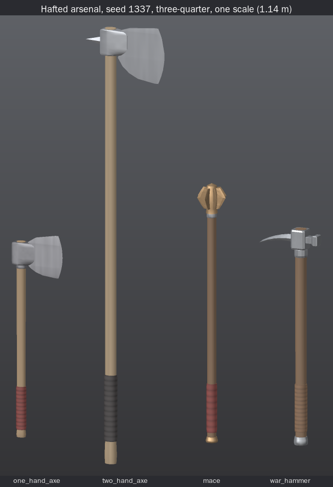
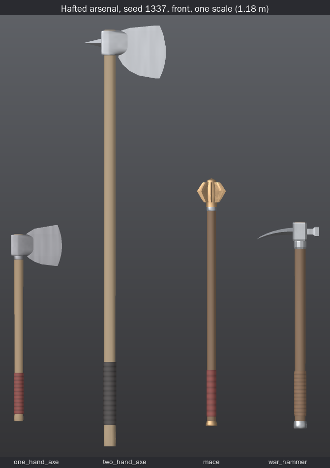
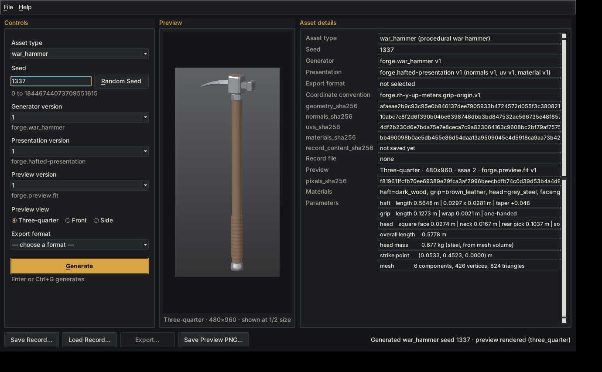
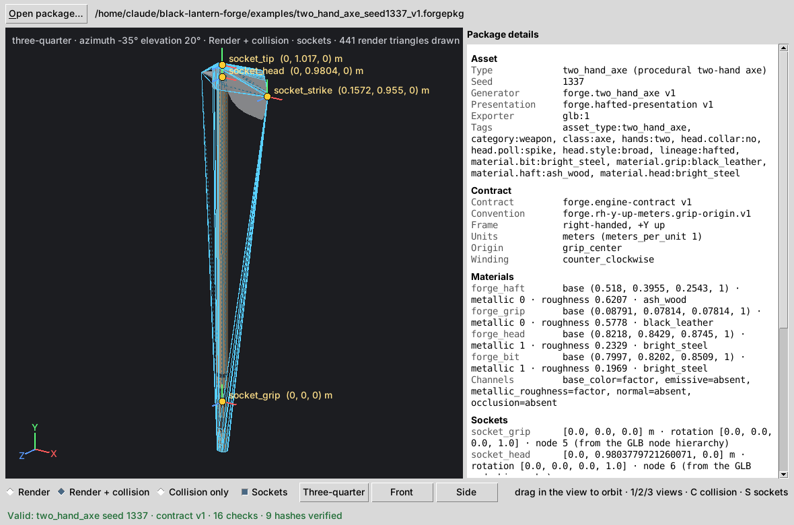
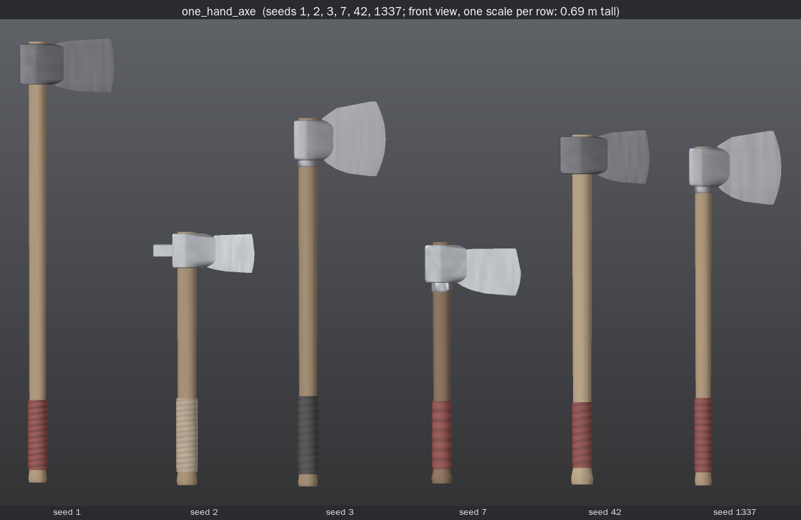
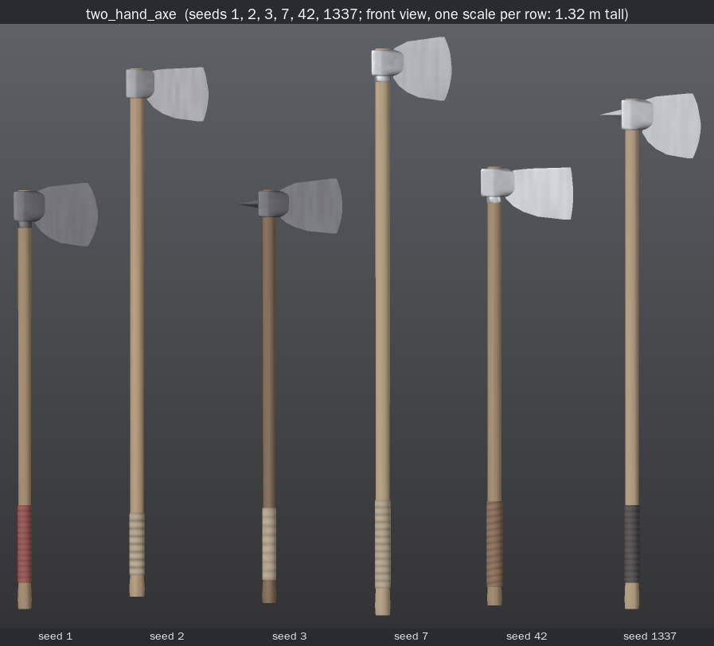
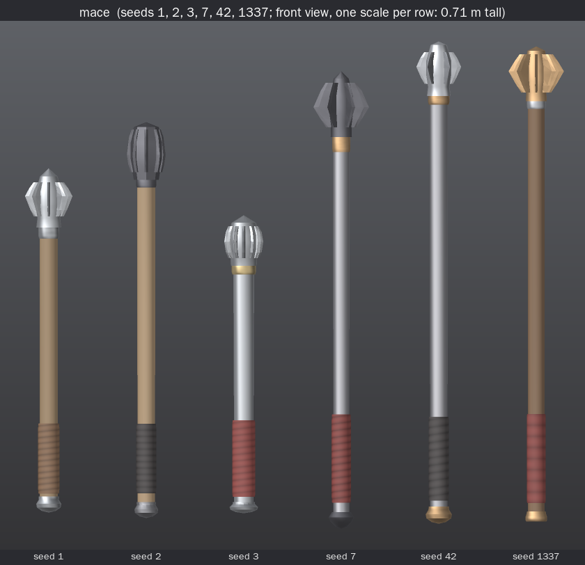
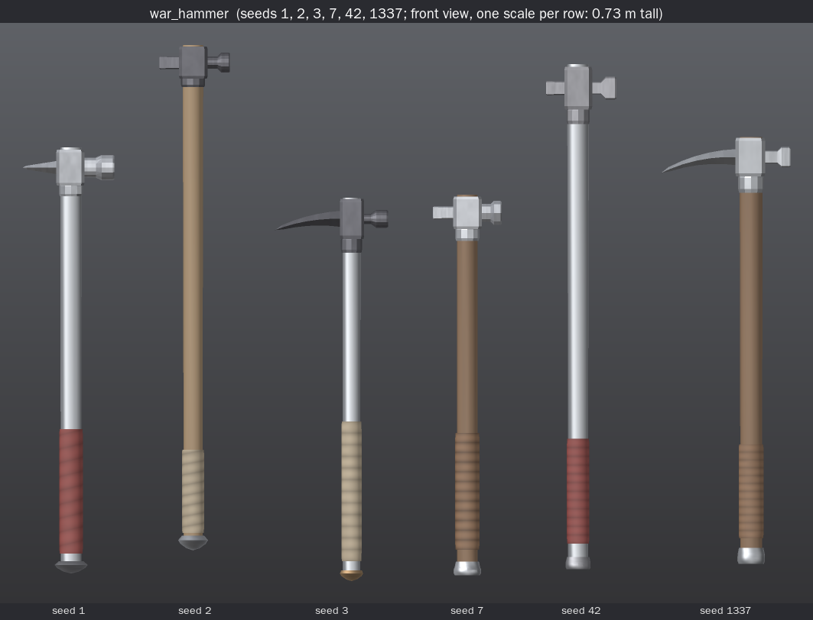

# First Arsenal: Hafted Weapons (Step 5B)

> Black Lantern Forge can deterministically generate, present, persist, preview, export, validate,
> and independently ingest multiple registered rigid hafted weapon families without changing frozen
> blade-family behavior.

That is the whole claim. It does not cover:

- spears, polearms, halberds, glaives or bardiches
- crossbows or firearms, or bayonet mounting
- projectiles, attack speed, damage, animation, rigs or physics
- flexible or chain weapons, flails or whips
- historical named presets
- any game engine



**BLACK LANTERN FORGE STEP 5B — FIRST ARSENAL: HAFTED WEAPONS — FROZEN**

Frozen after the realism pass (§16) and the final visual review of its lineups. All four generators
are v1. The revised axe and war-hammer outputs are part of the original v1 definition, because
Step 5B had not been frozen or released before them. The seed-1337 goldens in §11 are the frozen
outputs, and the limitations in §14 stand as documented.

## 1. What Step 5B adds

Four production families, each with its own explicit identity. Nothing resolves to "latest".

| asset_type | generator | presentation | preview | exports | components |
|---|---|---|---|---|---|
| `one_hand_axe` | `forge.one_hand_axe` v1 | `forge.hafted-presentation` v1 | `forge.preview.fit` v1 | `glb:1`, `obj:2` | haft, grip, head, bit |
| `two_hand_axe` | `forge.two_hand_axe` v1 | `forge.hafted-presentation` v1 | `forge.preview.fit` v1 | `glb:1`, `obj:2` | haft, grip, head, bit |
| `mace` | `forge.mace` v1 | `forge.hafted-presentation` v1 | `forge.preview.fit` v1 | `glb:1`, `obj:2` | haft, grip, collar, head, flanges, butt_cap |
| `war_hammer` | `forge.war_hammer` v1 | `forge.hafted-presentation` v1 | `forge.preview.fit` v1 | `glb:1`, `obj:2` | haft, grip, head, face, rear, butt_cap |

```bash
python -m forge generate one_hand_axe --seed 1337 --generator-version 1 --presentation-version 1
python -m forge generate mace --seed 7 --generator-version 1 --presentation-version 1 \
    --save output/mace7.json --preview output/mace7.png --export glb:1 --out output/mace7.forgepkg
python -m forge load output/mace7.json
python -m forge_engine_viewer output/mace7.forgepkg --validate-only
```

## 2. The architectural test

The brief asked whether new families would need family branches in generic code. **They did not.**

The four families run end to end through code that Step 5B left byte-identical:

- records
- registry dispatch
- CLI routing
- hashing
- the OBJ format 2 writer
- the GLB writer, package builder and validator
- the preview rasterizer and the Step 5A fit framing
- Forge Desktop
- the Step 4 viewer

**Pinned sources.** Tests pin every frozen source:

- the 57 generic sources at their Step 4 hashes (`tests/arsenal_frozen_sources.json`)
- the 13 Step 5A blade sources at their Step 5A hashes (`tests/hafted_frozen_sources.json`)

**Source guard.** It rejects any of the following in generic code, or in the Step 5A blade code:

- a hafted family name or identifier
- an import of the hafted code
- a comparison against an asset-type literal

It covers persistence, the registry, CLI dispatch, the package exporter and validator, desktop
routing and the viewer.

**Existing product files that changed:**

| File | Change |
|---|---|
| `forge/catalog.py` | Registration data only. It imports `forge.assets.hafted` and appends its entries. It adds `forge.hafted-presentation` v1 to the accept-lists of `obj:2` and `glb:1`. A test checks that the catalog has no conditional on an asset type. |
| `forge/__init__.py` | `__version__` 0.5.0 → 0.6.0. It is informational only: it appears in a record's `info` block, which every hash excludes. |
| `pyproject.toml` | distribution version 0.5.0 → 0.6.0 |

**Reused from Step 5A, unchanged:**

- `forge.blades.shapes.sweep` and `Ring`: the general closed sweep
- `forge.blades.presentation.compute_normals` and `compute_uvs`: the crease-normal and box/cylindrical UV algorithms
- `forge.preview.fit` v1: geometry-bound framing, which fits the new families with no change

Nothing in the blade code was modified to make this reuse possible.

### Contract v1 was sufficient

Contract v1 handled everything the families needed. A prototype with six render nodes and five
sockets confirmed this before any family was written:

- any number of render nodes
- extra `socket_*` names
- the collision hull

Two Contract v1 facts shaped the design:

- **`socket_tip` is required on every package.** For a hafted weapon it marks the distal end on
  the primary axis: the haft's top center for axes and the hammer, and the head's top point for
  the mace. The manifest states this derivation for each socket.
- **Forge's package builder allows only identity socket rotations.** Strike sockets therefore
  carry a position and no direction (§9).

The coordinate convention is reused unchanged: `forge.rh-y-up-meters.grip-origin.v1`, which is
right-handed, +Y up, in meters, with the grip-centered origin. Its manifest field
`blade_tip_axis: +Y` keeps its Step 1 name. For a hafted weapon it reads as "the weapon's distal
end points +Y".

## 3. Hafted-family architecture

```
forge/hafted/                     (new)
  shapes.py      primitives: profiles (chamfered rect, wedge, flange/rib/lobe), merge, exact
                 rotation about Y, Cayley rotation, haft loft, grip wrap, collar ring, butt caps,
                 eye block (war hammer socket), slice stack, free-form convex slice stack (the
                 forged axe eye), x-sweeps, bent sweeps, radial elements
  model.py       HaftGeom, GripGeom, ButtCapGeom, Joint, HaftedAsset, checks
  haft.py        the shared haft, grip wrap and butt cap: layout, stations, draws
  axe.py         the shared axe builder and rules for both axe families
  one_hand_axe.py, two_hand_axe.py, mace.py, war_hammer.py   the four v1 generators
  presentation.py  forge.hafted-presentation v1
forge/assets/hafted.py   registry entries, integrity functions, engine adapters (sockets, tags)
```

Flow for every family, all through the registry:

```
seed ─▶ family.draw_params(seed)      one PCG32 stream per component
     ─▶ validate(params)              ranges and proportions; fail closed, nothing clamped
     ─▶ build                         separate closed shells, seated into each other
     ─▶ validate_assembly(asset)      overall length, head mass from mesh volume, leverage
     ─▶ HaftedAsset (components + params + landmarks + joints)
     ─▶ derive_hafted_presentation   PresentedSword container (the frozen generic one)
     ─▶ record / preview / obj:2 / glb:1 / validate / viewer / desktop: unchanged generic code
```

`HaftedAsset` exposes the interface the generic code already reads:

- `asset_type`, `generator`, `generator_version`, `seed`
- `components`, `component_names`, `to_dict()`

It adds:

| Field | Meaning |
|---|---|
| `params` | the family's parameter dataclass |
| `landmarks` | named points: `grip_center`, `head_center`, `strike_point`, `tip`, … |
| `joints` | where one part is seated inside another |
| `head_mass_kg` | steel-equivalent mass of the head: its parts' closed-shell volumes less the haft passing through them |

## 4. Shared primitives and assembly

The primitives use only `+ - * /` and `sqrt`. There is no trigonometry, no `**`, no `pow()` and
no `sum()`, and a source guard enforces this.

**Radial directions.** Flanges, ribs and lobes are spaced using `unit_circle(8 | 12)`, from exact
sqrt identities. The +X element is copied with no rounding at all, so its strike vertex is exact.

**Curved picks.** They turn by rational Cayley rotations.

**Every part is a closed, outward-wound shell.** Parts are seated into each other rather than
touching at a plane:

| Joint | How it is seated |
|---|---|
| haft through the head | The axe eye, hammer socket or mace head encloses the haft over its height. The axe eye's walls follow the haft's oval: full thickness beside it, rounded behind it, tapering cheeks in front. The haft stands 1–5 mm proud of an axe or hammer, or ends inside a mace head. |
| collar | It rings the haft and rises 3–4 mm into the head's base. |
| axe bit | Inside the eye's height its back follows the cheeks' front, 1.5 mm behind it, so the cheeks run straight into the bit's flats. |
| hammer face and rear | Their bases start 3 mm inside the socket's walls. |
| mace elements | Their inner edges are buried in the head. |
| grip wrap and butt cap | They enclose the haft over the grip zone and over its end. |

Every joint is recorded on the asset and checked geometrically by the tests. Each selected vertex
of the inner part must lie inside the outer part, using an independent winding-number test.
The parts must also form one connected assembly through the joints, so nothing floats. A
negative test moves a head, bit, face or butt cap by a few millimeters and confirms the check
catches it.



## 5. Plausibility rules (reject, never clamp)

Each family validates its parameters before building and its assembly after. Any failure raises
`GenerationError`. Rules cover:

- **Ranges:** the haft, grip, head, bit, face, rear, elements and butt cap
- **Axes:**
  - edge height
  - bit reach beyond the eye relative to the eye's thickness
  - head length, absolute and relative to haft length
  - that the beard and horn reach forward of the neck
  - that the bit's neck lies inside the eye
  - two-handed spacing between the hands
- **Mace:**
  - head radius relative to haft radius (1.6–4.6)
  - head width (≤ 0.11 m)
  - element projection relative to the core
  - element counts per form
  - collar thickness relative to the head's wall
- **War hammer:**
  - face size relative to neck (1.2–2.2)
  - face size relative to the socket (≤ 1.0)
  - that neck and rear bases fit the socket
  - rear reach relative to face reach (≤ 3.8)
  - head length (≤ 0.25 m)
  - rear-style length and turn limits
- **Assembly:**
  - overall length
  - head mass
  - head mass per haft cross-section
  - leverage, the head mass times its height above the grip center, for one-handed weapons

Every draw lies inside its rules. 20,000 seeds per family were swept and all generate.

## 6. The families

Ranges are measured from the generated weapons over seeds 1–1000.

| | one_hand_axe | two_hand_axe | mace | war_hammer |
|---|---|---|---|---|
| overall length | 0.36–0.72 m | 0.86–1.47 m | 0.42–0.72 m | 0.46–0.73 m |
| haft length | 0.36–0.70 m | 0.86–1.42 m | 0.37–0.66 m | 0.45–0.72 m |
| grip zone | 0.09–0.13 m | 0.14–0.22 m (lower hand) | 0.10–0.14 m | 0.10–0.19 m |
| head mass (steel est.) | 0.41–1.12 kg | 0.69–1.55 kg | 0.40–1.33 kg | 0.36–0.84 kg |
| head | edge 0.05–0.12 m, reach 0.10–0.15 m | edge 0.10–0.17 m, reach 0.14–0.20 m | width 0.045–0.092 m, height 0.054–0.100 m | face 0.024–0.040 m, rear 0.018–0.120 m |
| hands | one | two | one | one, or hand-and-a-half (grip ≥ 0.15 m) |

Each family draws from its own isolated PCG32 streams, one per component:

| Family | Streams (`forge.<family>.<component>`) |
|---|---|
| axes | `haft`, `grip`, `head`, `bit` |
| mace | `haft`, `grip`, `collar`, `head`, `flanges`, `butt_cap` |
| war_hammer | `haft`, `grip`, `head`, `face`, `rear`, `butt_cap` |

Every value is drawn unconditionally, in a fixed order. Test 14 changes one stream at a time and
checks that every other stream's draws are bit-identical.

Materials draw from separate streams, `forge.hafted-presentation.material.v1.<family>.<component>`,
so they can never move geometry.

### one_hand_axe

A compact, one-handed chopping axe on an oval haft with a flared knob. The head is a forged eye
with a flat poll, plus a wedge bit. Styles (broad shapes, not named presets):

| Style | Shape |
|---|---|
| `compact_bearded` | moderate beard |
| `crescent` | horn and beard |
| `broad_utility` | tall neck, longer poll |
| `narrow_battle` | narrow neck, long reach |
| `hammer_poll` | a squared hammer face behind the eye |

An optional collar sits below the eye.

**The bit** is a stack of horizontal slices. Each slice is a wedge profile: full cheek thickness
at the back, a secondary bevel, and a sharp edge vertex.

- The edge is a convex arc: `x_edge = projection − bulge·u²`.
- The beard and horn back lines are quarter-ellipses from the neck:
  `x_back = x_neck + span·(1 − √(1 − q²))`.
- The cheek thins at a constant wedge slope.

**The eye** (both axe families) is a stack of 10 horizontal slices, each a convex 16-point teardrop
around the haft:

- **Behind the haft** a quarter ellipse rounds the side walls into the poll's face. The face is
  70% of the wall's thickness for a flat poll, 74% for a spike and 84% for a hammer poll.
- **Beside the haft** the wall keeps its drawn thickness.
- **In front of the haft** the cheeks taper at about 17° a side, with a slight swell, to a narrow
  front just 0.3 mm thicker than the bit there.

At the neck the cheeks reach forward and run into the bit's flats. Above and below the neck they
draw back along a parabola to a quarter of that reach, so the eye ends as rounded lugs around the
haft. The poll's top and bottom corners are rounded and the end slices bevelled 6%. Inside the
eye the bit's back follows the cheek front 1.5 mm behind it, so the hidden bit does not double
the head's estimated volume. Outside the eye the bit is exactly its drawn shape, and its strike
vertex is unchanged.

### two_hand_axe

A long-hafted, two-handed axe with a thin, wide bit:

| Style | Shape |
|---|---|
| `broad` | wide, thin, flaring bit on a narrow neck |
| `bearded` | long beard under a taller neck |
| `crescent` | deep, strongly curved edge with horn and beard |

The poll is flat or a short rear spike. The grip zone at the origin is the lower hand. The upper
hand's zone sits below the head, recorded as landmarks, at least 0.12 m from the lower grip.

**The head does not scale with the haft.** It is drawn on its own ranges, and the rules cap head
length at 0.30 m and 32% of the haft. A test checks this: the shortest and longest hafts carry
the same range of heads, with means within 12 mm.

### mace

A rigid, one-handed mace. The head is a turned core, round (16 sides) or faceted (8), with a domed
top. Its radial striking elements are all in one part:

| Form | Elements | Core |
|---|---|---|
| `flanged` | 6 or 8 thin, tall plates | tube-like |
| `ribbed` | 8 or 12 low ridges | bulbous |
| `lobed` | 6 or 8 rounded lobes | bulbous |

Each element's outline follows the core's silhouette, and its inner edge is buried in the core.
Below the head sits a collar. The butt cap is a knob, a disc or a cone. There are no chains or
flails: every part is rigid and fixed.

### war_hammer

A one-handed or hand-and-a-half horseman's-style hammer:

- **Head:** a socket block with a collar.
- **Face:** a neck that flares into a square, octagonal or round face.
- **Rear:** one of
  - a downward-curving pick (0.065–0.12 m)
  - a straight spike (0.04–0.07 m)
  - a short narrow poll (0.018–0.032 m)
- **Butt cap.**

It is a hand weapon. The rules hold the rear to 3.8× the face's reach and the head to 0.25 m,
so it cannot become a polearm-class lucerne hammer. The haft is 0.445–0.72 m, so the head is never
dwarfed by it: its length is at least 0.107 of the haft's over seeds 1–1500, and at least 0.151
for nine in ten.

## 7. Presentation: `forge.hafted-presentation` v1

A new presentation family. The frozen `forge.presentation` v1 and `forge.blade-presentation` v1
are untouched. It outputs the frozen `PresentedSword` container, so records, previews, `obj:2`
and `glb:1` consume it unchanged.

| Part | Normals | UVs | Material |
|---|---|---|---|
| haft | smooth (crease cos 0.80; 12-sided haft) | cylindrical | wood (ash, oak, hickory, dark); on the mace and hammer, also iron or steel |
| grip | smooth (crease 60°) | cylindrical | leather or cord wrap (wrap pattern) |
| axe head (eye, poll, collar) | crease cos 0.80: the eye's cheeks and rounded back shade smooth; its top, bottom, poll face and hammer or spike stay hard | box | forged iron or steel (patina) |
| axe bit | crease cos 0.94 (~20°): smooth along the edge's curve, hard bevels | box | the head's preset (brushed) |
| mace head | crease 30°: a 16-sided core shades round, an 8-sided one faceted | cylindrical | iron, steel or bronze (patina) |
| mace flanges | faceted | box | the head's preset |
| mace collar, butt caps | smooth | cylindrical | fittings (brass, bronze, steel, iron), or the head's preset on a coin-flip draw |
| hammer head, face, rear | faceted | box | the head's preset; face and rear brushed |

The bit uses a 20° crease rather than full faceting, a deliberate deviation from the brief's
suggestion. A faceted slice stack shows horizontal banding along the curved edge, while the
crease keeps every bevel hard.

## 8. Preview

All four families use the existing generic `forge.preview.fit` v1. It frames every vertex with a
6% margin, and a test checks this for three views and six seeds per family. The short sword keeps
`forge.preview` v1, and the blade families keep their goldens; tests 61–65 pin both.

## 9. Sockets, collision, Contract v1

All sockets use identity rotations.

| Socket | Families | Translation |
|---|---|---|
| `socket_grip` | all | `[0, 0, 0]`. The adapter checks that the grip wrap's bounding-box center is within 1e-9 m of the origin. |
| `socket_head` | all | the head's reference center on the haft axis: the middle of the socket's height (axes, hammer) or of the head's height (mace) |
| `socket_strike` | all | **axes:** the edge's furthest-forward vertex, at the middle of the edge's height. **mace:** the outer edge vertex of the +X element at its widest slice. **war hammer:** the face's center vertex. Always a real render vertex; the adapter refuses anything else. |
| `socket_tip` | all (Contract v1 requires it) | the distal end on the primary axis: the haft's top center (axes, hammer) or the head's top point (mace) |
| `socket_secondary_strike` | war_hammer | the rear's far end: the point of a pick or spike, or the center of a poll's face |

**Limitation.** Identity rotations mean a strike socket says where the strike lands, not which
way it faces. That needs oriented sockets, a contract-level decision deferred past Step 5B.

**`collision_hull`.** The frozen exact convex hull of every LOD0 render vertex. It validates, is
closed (faces = 2 × vertices − 4), contains every render vertex, and is inspected by the viewer
with no family code.

## 10. Persistence, packages, viewer, desktop

- **Records.** The generic schema, unchanged. Integrity is geometry, normals, UVs and materials,
  plus `record_content_sha256`. A reload verifies 6 checks and reproduces the geometry (bit for
  bit), the materials, the preview pixels and the GLB package bytes.
- **Packages.** `glb:1` through the unchanged writer. Byte-identical across processes and hash
  seeds. The four goldens pass the Khronos glTF validator with 0 errors and 0 warnings.
- **Viewer.** The Step 4 viewer, byte-identical to Step 4, ingests every family. It checks 16
  rules, verifies 9 hashes and reads all sockets, including the hammer's fifth, as data. It also
  works in a fresh process with Forge absent from disk.
- **Desktop.** Forge Desktop lists all nine asset types from the registry. Generate, all three
  views, save, load, preview save, OBJ and engine-package export work for every family, in the
  headless session and in the real Tk window.





## 11. Golden fixtures (seed 1337)

All goldens are in `examples/`:

- `<family>_record_seed1337.json`
- `<family>_preview_seed1337_three_quarter.png`
- `<family>_seed1337_v1.forgepkg/`

Every hash, socket, collision count and dimension is in `hafted_seed1337.golden.json`. The
previous goldens were not touched.

| | one_hand_axe | two_hand_axe | mace | war_hammer |
|---|---|---|---|---|
| style | crescent, flat poll, collar | broad, spike poll | 8 flanged, round core | square face, pick |
| geometry_sha256 | `7f0b6160…2355` | `a29d51c6…b85a` | `defc9102…2a69` | `afaeae2b…0303` |
| record_content_sha256 | `b87b92df…1369` | `24f3f377…6f25` | `f524b68a…6d31` | `b5c72522…b80e` |
| preview pixels_sha256 | `d53382e4…89f9` | `91de9e7a…b1a6` | `974fe6da…c069` | `f819611f…0154` |
| asset.glb sha256 | `5c8cf46b…4493` | `b0d9ba22…1ebd` | `e07bcc9c…bc43` | `a4cbfb63…56f0` |
| manifest.json sha256 | `8553ccfd…9d87` | `a91c4912…fcf5` | `deb27f20…55c4` | `9be0d9c6…15c7` |
| overall length | 0.5482 m | 1.1778 m | 0.6936 m | 0.5778 m |
| head mass (est.) | 0.832 kg | 1.216 kg | 0.587 kg | 0.677 kg |
| socket_strike | (0.12088, 0.41349, 0) | (0.15715, 0.95504, 0) | (0.04041, 0.56531, 0) | (0.05330, 0.45234, 0) |
| LOD0 | 881 v / 1014 t | 808 v / 934 t | 1554 v / 1176 t | 1066 v / 824 t |
| collision hull | 107 v / 210 t | 96 v / 188 t | 65 v / 126 t | 79 v / 154 t |

The mace's goldens are byte-identical to before the realism pass.

## 12. Lineups

Seeds 1, 2, 3, 7, 42 and 1337, front view, one fixed scale per family. The combined image at the
top puts all four at one common scale. They allow judging proportions, silhouette, variety,
exaggeration, head-to-haft contact and overall plausibility.






## 13. Tests

There are 98 new tests in 8 files. The full suite is 626 tests.

| File | Brief tests | Also covers |
|---|---|---|
| `test_hafted_families.py` | 1–5, 22 | CLI |
| `test_hafted_geometry.py` | 6–21, 23–33 | stream and material isolation, the seating negative test, plausibility refusals, source guards, the realism pass (forged eye, cheek-to-bit continuity, buried bit back, war-hammer head-to-haft floor) |
| `test_hafted_presentation.py` | 34–37, 40, 60 | fit framing |
| `test_hafted_persistence.py` | 38, 39, 59 | fail-closed records |
| `test_hafted_engine.py` | 41–49, 58 | the socket adapter failing closed |
| `test_hafted_viewer.py` | 50–55 | Forge-absent ingestion |
| `test_hafted_desktop.py` | 56, 57 | real window |
| `test_hafted_frozen.py` | 61–72 | the architectural source guard, no Contract v2 |

### Disclosed edits to frozen test files

Registering four more asset types and a third presentation family broke assertions that pinned
the registry's exact contents. They were fixed with minimal edits; no test count changed:

| File | Step | Edit |
|---|---|---|
| `tests/test_registry_core.py` | 2.5 | the expected `asset_types()` lists nine types; the `obj:2` accept-list includes `forge.hafted-presentation` v1 |
| `tests/test_registry_family.py` | 2.5 | the expected production `asset_types()` lists nine types, plus `test_tetra` |
| `tests/test_desktop_session.py` | 2.75 | the expected asset-type list has nine types |
| `tests/test_engine_export.py` | 3 | the `glb:1` accept-list includes `forge.hafted-presentation` v1 |
| `tests/test_arsenal_families.py` | 5A | the expected asset types, generator ids and presentation ids include the hafted entries |
| `tests/test_arsenal_desktop.py` | 5A | the expected asset-type list has nine types |
| `tests/test_arsenal_frozen.py` | 5A | the "new product files" check ignores Step 5B's own files (`forge/hafted/`, `forge/assets/hafted.py`), which the Step 5B suite pins instead |

## 14. Known limitations

- **Geometry.**
  - Simple lofted, swept and stacked shapes, low-poly by design.
  - Parts are separate closed shells seated into each other, not welded.
  - The axe eye is a 16-point slice stack: a forged shape at low poly. The eye's hole is not
    modelled (the haft is a separate solid inside it), its cheeks taper along a straight line
    with one swell point, and a faint crease remains where the cheeks meet the bit's flats.
  - The war hammer keeps its squared socket block, which suits a hammer.
  - There are no langets, rivets, haft wedges, fullers on the bit, or engraving.
- **Sockets** carry identity rotations: positions only (§9).
- **Head mass** is a steel-volume estimate. Overlapping shells inside one part count twice, as does
  the 1.5 mm of an axe bit seated in the cheeks, and wooden versus metal hafts are not weighed.
- **Proportions** are plausible envelopes, not historical presets. Mace heads are solid cores,
  heavier than the hollow tube sockets of many real flanged maces.
- **Inherited names.**
  - The OBJ format 2 header comment and the convention field `blade_tip_axis` keep their
    sword-era wording; both are frozen.
  - The presentation container is still named `PresentedSword`.
- **Platforms.**
  - Byte stability was verified on CPython 3.10–3.13 on x86-64 Linux only.
  - The desktop was tested under a virtual X display only.

## 15. Deferred (explicitly NOT in Step 5B)

| Area | Deferred |
|---|---|
| Step 5C | spear, general polearm family (including polearm-class hammers) |
| Step 5D | crossbow, flintlock pistol and rifle, bayonet attachment compatibility |
| Later | historical lineages and named presets, attachment composition, oriented sockets or a Contract v2 if justified, animation, gameplay |
| Never in 5B | flails, chains, whips, physics, damage, attack speed, game engines, Black Lantern OS |

## 16. Realism pass (pre-freeze revision)

A final correction pass, limited to the hafted weapons' presentation geometry. Identities, streams,
draw orders, contract and package format are unchanged: `forge.one_hand_axe`, `forge.two_hand_axe`,
`forge.mace` and `forge.war_hammer` are still v1, because Step 5B had not been frozen or released.

| Change | Families | Effect |
|---|---|---|
| The box-shaped eye replaced by a forged eye: a teardrop around the haft, tapering cheeks that run into the bit, rounded lugs at the top and bottom, rounded poll corners (§6) | both axes | new geometry, normals and goldens. Edge, strike point, head length, width, thickness and every socket position are unchanged. Head mass rose 1–4% (seeds 1–1000). |
| Inside the eye, the bit's hidden back follows the cheeks | both axes | removes most of the hidden overlap |
| Axe head normals: faceted → crease cos 0.80 | both axes | the eye shades as forged steel; hard edges stay hard |
| Haft length 0.445–0.86 m → 0.445–0.72 m | war_hammer | long hafts no longer dwarf the head; overall 0.46–0.73 m |
| Poll rear length 0.012–0.024 m → 0.018–0.032 m | war_hammer | the smallest heads (poll rear) gain about a centimetre |
| none | mace | byte-identical goldens |

Every frozen short-sword and Step 5A blade output is unchanged.

| Measure, seeds 1–1000 (min / median / max) | before | after |
|---|---|---|
| one_hand_axe head mass (kg) | 0.401 / 0.707 / 1.115 | 0.413 / 0.716 / 1.116 |
| two_hand_axe head mass (kg) | 0.685 / 1.029 / 1.545 | 0.685 / 1.058 / 1.550 |
| war_hammer head mass (kg) | 0.348 / 0.534 / 0.820 | 0.364 / 0.541 / 0.843 |
| war_hammer overall (m) | 0.455 / 0.659 / 0.872 | 0.455 / 0.591 / 0.733 |
| axe head width, thickness, height | — | identical distributions |

Two new derived rules guard the eye: the cheeks must reach at least 4 mm beyond the eye's front
wall and no further than half the bit's reach, and the bit must be thin enough for them to taper
into. 20,000 seeds per family still all generate.
