# Character Forge one-shot — measured results

Every number below was produced by `tools/run_demos.py` in this run; every image in `renders/` is the actual generated geometry drawn by the in-repo software rasterizer. Engineering notes: [`docs/CHARACTER_FORGE_AAA_ONESHOT.md`](../../docs/CHARACTER_FORGE_AAA_ONESHOT.md).

## A. Baseline character

`glb/ada.glb` (public profile): 13 meshes, 99196 vertices, 194619 triangles, 64 joints, 16 morph targets, 8 animations, 9 materials, 6 embedded textures.

* Structural validator: **pass**
* Independent Node.js loader re-skinned 600 body vertices of `walk` frame 8 from the GLB alone: **pass**, max deviation from the Python pipeline 7.52e-08 m
* Body surface vs. its field: mean residual 0.0 mm; flipped triangles vs. template 7; degenerate 0
* Determinism: exporting the same DNA twice gave identical SHA-256 = **True** (`f193e8543fe26b12…`)

| part | vertices | triangles |
|---|---:|---:|
| body | 62639 | 125282 |
| eye_l | 1082 | 2160 |
| cornea_l | 241 | 440 |
| eye_r | 1082 | 2160 |
| cornea_r | 241 | 440 |
| teeth_upper | 3204 | 6404 |
| teeth_lower | 4830 | 9656 |
| eyebrows | 60 | 56 |
| eyelashes | 68 | 64 |
| hair_cap | 9837 | 19398 |
| hair_long | 713 | 1320 |
| tshirt | 8586 | 16919 |
| shorts | 5274 | 10320 |

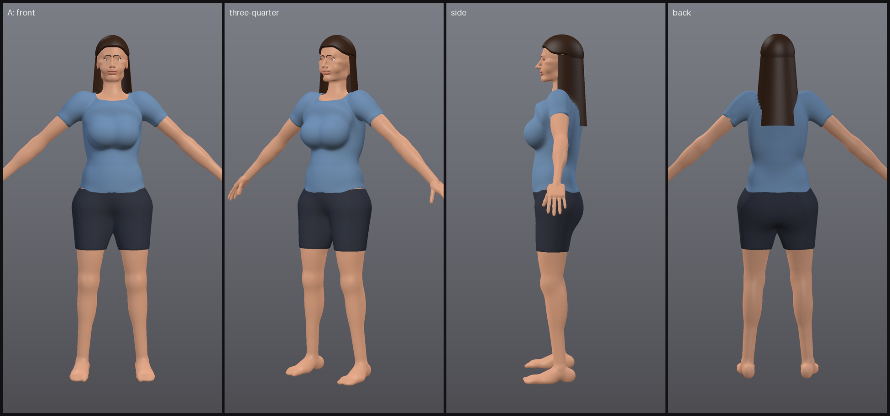
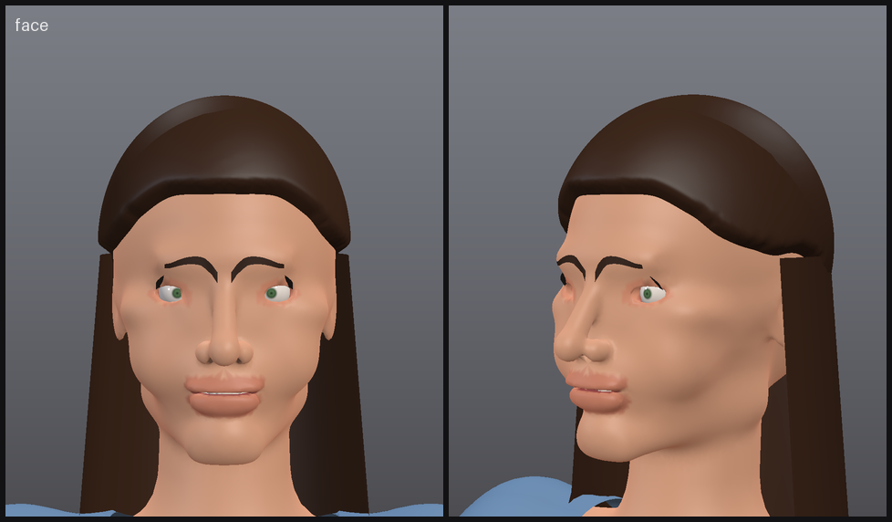
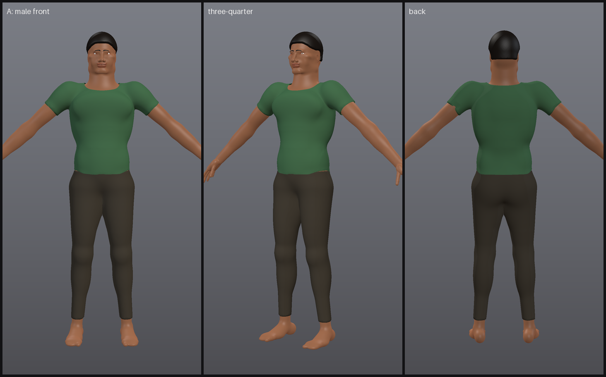

## B. Customization (same topology, different geometry)

Same vertex count: **True**, identical triangle list: **True**. Mean vertex displacement 0.084 m (max 0.120 m); 100.0% of vertices moved more than 1 mm. Height 1.657 m → 1.776 m. Both DNA files are in `dna/` (`ada.dna.json`, `ada_variant.dna.json`).

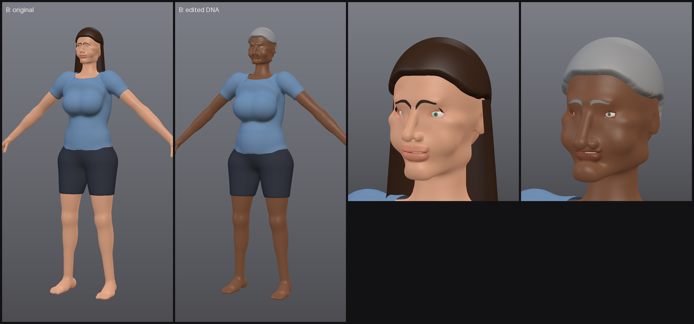

## C. Skeletal deformation and face controls

Max body-vertex motion caused by each pose (LBS through the exported skin weights):

| pose | max vertex motion (m) |
|---|---:|
| contrapposto | 0.469 |
| lunge | 0.627 |
| walk frame 8 | 0.538 |
| seated | 0.654 |

| morph target | max displacement (m) | vertices moved |
|---|---:|---:|
| blink_l | 0.0077 | 376 |
| blink_r | 0.0077 | 363 |
| smile | 0.0059 | 5558 |
| brow_raise | 0.0043 | 5693 |
| frown | 0.0025 | 1456 |
| pucker | 0.0039 | 2874 |
| lips_part | 0.0021 | 989 |
| shape_body_fat | 0.0425 | 18441 |
| shape_muscle | 0.0072 | 20984 |
| shape_breast_size | 0.0274 | 2834 |

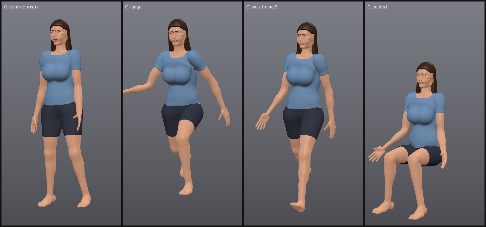
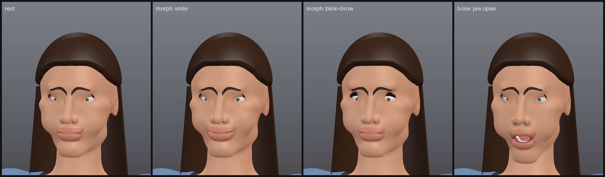

## D. Image-to-3D and full-body completion

Method: classic CV segmentation + head-unit silhouette measurement + analysis-by-synthesis procedural fitting. No pretrained, landmark or generative model. References are renders/drawings generated in-repo (`references/PROVENANCE.md`).

| reference | posture | style | observed | estimated | invented | fit residual (head units) | complete body height (m) |
|---|---|---|---:|---:|---:|---:|---:|
| ref_full_front.png | standing | realistic | 7 | 11 | 32 | 0.2305 | 1.66 |
| ref_waist_up.png | standing | realistic | 4 | 8 | 38 | 0.3032 | 1.75 |
| ref_portrait.jpg | standing | realistic | 3 | 5 | 41 | 0.3815 | 1.75 |
| ref_seated.png | seated | realistic | 5 | 9 | 36 | 0.3211 | 1.78 |
| ref_stylized_drawing.png | standing | stylized | 7 | 10 | 33 | 0.1896 | 1.78 |

Recovered parameters for `ref_full_front.png` vs. the ground truth it was rendered from:

| trait | estimate | truth | abs error | provenance | confidence |
|---|---:|---:|---:|---|---:|
| body.body_fat | 0.14 | 0.3 | 0.16 | estimated | 0.3 |
| body.calf_thickness | 0.93 | 1.0 | 0.07 | observed | 0.144 |
| body.chest_width | 0.89 | 0.95 | 0.06 | estimated | 0.086 |
| body.femininity | 1.0 | 1.0 | 0.0 | estimated | 0.6 |
| body.head_size | 1.0 | 1.0 | 0.0 | observed | 0.144 |
| body.height_m | 1.66 | 1.66 | 0.0 | estimated | 0.2 |
| body.hip_width | 0.98 | 1.08 | 0.1 | estimated | 0.086 |
| body.leg_length | 0.95 | 1.04 | 0.09 | observed | 0.144 |
| body.shoulder_width | 1.0 | 0.92 | 0.08 | estimated | 0.086 |
| body.thigh_thickness | 0.69 | 1.04 | 0.35 | estimated | 0.086 |
| body.waist_width | 1.03 | 0.9 | 0.13 | estimated | 0.086 |
| face.face_width | 1.11 | 0.95 | 0.16 | estimated | 0.072 |

**ref_full_front.png** — regions: head=visible, neck=visible, shoulders=visible, chest=visible, arms_upper=visible, waist=visible, hips_pelvis=visible, hands=visible, thighs=visible, knees=visible, lower_legs=visible, feet=visible, back=unobservable

**ref_waist_up.png** — regions: head=visible, neck=visible, shoulders=visible, chest=visible, arms_upper=visible, waist=visible, hips_pelvis=cropped, hands=cropped, thighs=cropped, knees=cropped, lower_legs=cropped, feet=cropped, back=unobservable  
notes: reference cropped at ~3.3 head units: lower body completed from presets

**ref_portrait.jpg** — regions: head=visible, neck=visible, shoulders=visible, chest=cropped, arms_upper=cropped, waist=cropped, hips_pelvis=cropped, hands=cropped, thighs=cropped, knees=cropped, lower_legs=cropped, feet=cropped, back=unobservable  
notes: head-and-shoulders/portrait reference: body below the shoulders is completed from presets | close-up framing: head-relative proportions are perspective-sensitive and blended with priors

**ref_seated.png** — regions: head=visible, neck=visible, shoulders=visible, chest=visible, arms_upper=visible, waist=visible, hips_pelvis=visible, hands=visible, thighs=occluded_by_pose, knees=occluded_by_pose, lower_legs=occluded_by_pose, feet=occluded_by_pose, back=unobservable  
notes: figure is 6.1 heads tall with realistic shoulders (3.2 head widths): classified seated/crouched; leg proportions are not measured

**ref_stylized_drawing.png** — regions: head=visible, neck=visible, shoulders=visible, chest=visible, arms_upper=visible, waist=visible, hips_pelvis=visible, hands=visible, thighs=visible, knees=cropped, lower_legs=cropped, feet=cropped, back=unobservable  
notes: figure is 5.0 heads tall with 1.9-head-width shoulders: classified stylized proportions

Locks: after locking hair color, skin tone and shoulder width and regenerating `body` and `appearance` (seed 11), locked values unchanged = **True**; 33+ unlocked traits were re-sampled and marked `invented`; leg length was then corrected by the user and locked.

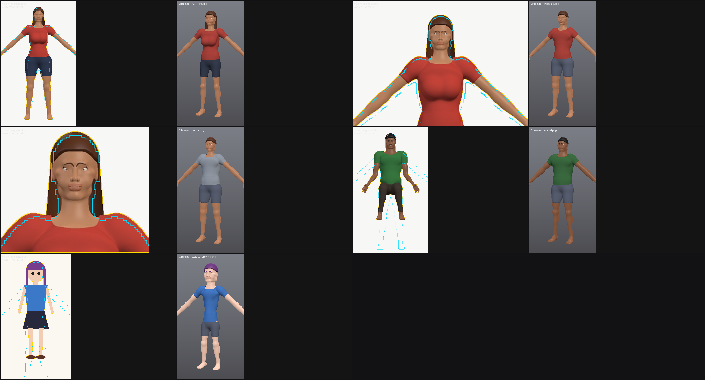
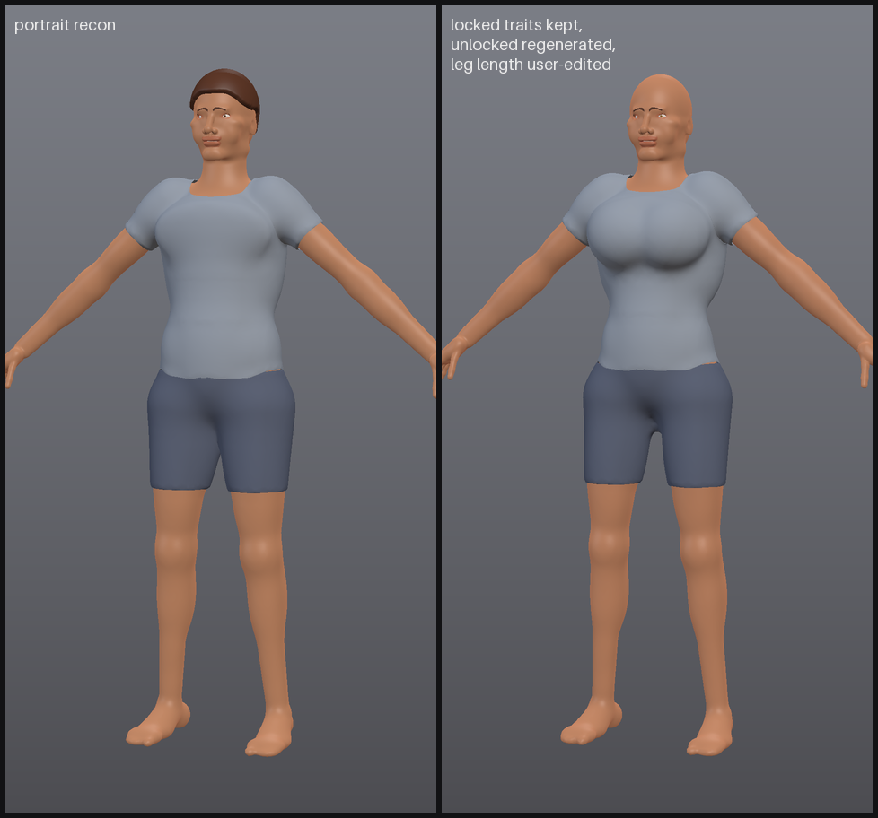

## E. Secondary physics

Numerical spring-damper simulation over the animated skeleton (120 Hz substeps), baked into glTF joint rotations (`*_secondary` clips). Breast chain on the `jump` clip:

| configuration | peak-to-peak tip deviation (mm) | max angle (deg) | stable |
|---|---:|---:|---|
| no support f=2.4Hz z=0.22 | 20.8 | 22.4 | True |
| t-shirt | 17.7 | 19.1 | True |
| bra | 9.6 | 10.7 | True |
| stiff f=4Hz z=0.5 | 21.0 | 21.8 | True |
| soft f=1.6Hz z=0.12 | 28.5 | 30.1 | True |

Developer-only genital chain (adult male DNA) on the `walk` clip:

| configuration | penis_02 amplitude (mm) | testicle_l amplitude (mm) | penetration before resolution (mm) | penetration in final state (mm) | stable |
|---|---:|---:|---:|---:|---|
| nude, colliders on | 16.2 | 11.6 | 0.77 | 0.03 | True |
| nude, colliders off | 16.2 | 9.1 | 0.00 | 16.57 | True |
| briefs support | 2.5 | 9.9 | 4.24 | 0.46 | True |

Developer GLB `glb/bram_developer.dev.glb` validates: **True**; dev parts: ['dev_genitals']. Public GLB contains dev parts: **False**. Developer anatomy is shown only as numeric plots here. Developer GLBs are written locally and deliberately not committed (`*.dev.glb` is git-ignored); regenerate with `tools/run_demos.py` or the CLI `export --profile developer`.

The `stiff` breast row is limited by its 22 degree cone, which is why its peak-to-peak deviation is close to the unsupported default; with a 60 degree limit the same spring measures far lower (see `tests/test_character_forge_dna_physics.py::test_damping_and_stiffness_are_tunable`).

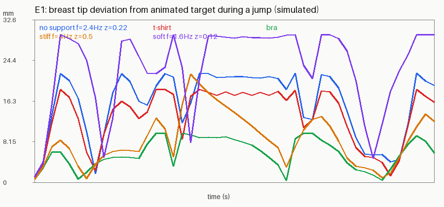
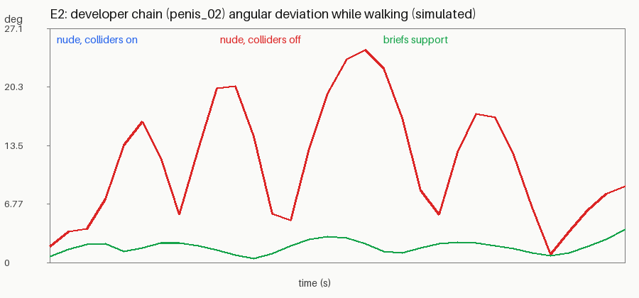
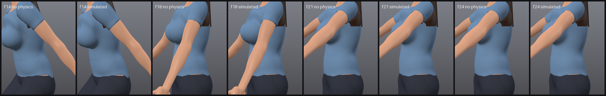

## Feature classification

| feature | status | evidence / limits |
|---|---|---|
| Human mesh generation (procedural SDF anatomy, male/female/neutral presets) | WORKING | A, B renders; closed oriented template; recognizable but not production-sculpt realism |
| Editable body parameters (29) with real geometric change | WORKING | B: identical topology, 100% vertices moved; extreme combined face edits fold some triangles |
| Fixed-topology editing | WORKING | same 62,639-vertex template for every character (tests) |
| Face controls (26 parameters) | WORKING | geometry changes per parameter; no identity-level likeness |
| Expression morph targets (blink L/R, smile, brow raise, frown, pucker, lips part) | WORKING | per-vertex deltas, exported as glTF morph targets |
| Body-shape morph targets for runtime sliders | WORKING | shape_body_fat / shape_muscle / shape_breast_size in ada.glb |
| Skeleton (64 public joints + 7 developer) | WORKING | hierarchy tests; humanoid name map in extras |
| Skin weights + LBS deformation | WORKING | C poses; independent Node.js re-skinning matches to 1e-7 m |
| Corrective blendshapes / dual-quaternion skinning | NOT ATTEMPTED | LBS only; shoulders/hips show classic LBS volume loss in extreme poses |
| Animation clips (idle, walk, jump, wave) | WORKING | procedural keyframes baked to glTF |
| Skin material (tone model, regional tint, procedural pore normal + roughness maps) | PARTIAL | plausible, not subsurface-scattered, no albedo texture painting |
| Eyes (iris texture, cornea), teeth/gums/tongue | WORKING | rigid-skinned to eye/jaw bones |
| Eyebrows, eyelashes (alpha cards) | PARTIAL | simple cards |
| Hair (cap, long sheet, bun, buzz) | PARTIAL | shell/sheet hair, no strands or hair cards with physics |
| Clothing (briefs, bra, t-shirt, shorts, pants, skirt, robe, loincloth) | PARTIAL | skinned shells; no cloth simulation; skirts are skinned to thighs |
| GLB export + structural validation | WORKING | validator + independent loader; deterministic bytes |
| Public / developer profiles, adult gate | WORKING | tests: no dev nodes in public, *.dev.glb naming, age >= 18 enforced |
| Character DNA (provenance, confidence, locks, sources, regeneration) | WORKING | D locks; tests |
| Image ingest (PNG/JPEG/WebP, validation, authorization) | WORKING | tests reject GIF, renamed GIF, truncated, tiny, unauthorized |
| Image-to-3D reconstruction | PARTIAL | silhouette-level fit only; parameter errors up to 0.35 on clothed regions; no facial landmarks |
| Partial-reference full-body completion (portrait, waist-up, seated) | WORKING | complete geometry for unseen regions, marked invented; editable and lockable |
| Stylized-art reinterpretation | PARTIAL | stylized proportions detected and clamped; garment types beyond shirt/shorts/pants not detected |
| Breast secondary physics | WORKING (numerical, baked) | tunable, garment support; not a soft-body tissue model |
| Male genital secondary physics (penis chain, testicles) | WORKING (numerical, baked) | colliders + briefs support; developer profile only |
| Garment interaction (support volumes, loincloth/skirt cloth bones) | PARTIAL | stiffness/damping scaling and bounds; no true cloth-body contact |
| Female external genital geometry | NOT ATTEMPTED | specification preserved; body has a smooth pubic surface |
| Detailed nipple/areola sculpting | PARTIAL | size/areola parameters, developer profile only |
| Blender integration | BLOCKED | Blender is not installed in this environment |
| Pretrained / generative image-to-3D | BLOCKED | no model available offline; nothing downloaded |
| LOD generation | NOT ATTEMPTED | single dense LOD (~195k triangles total per character) |
| Unreal/Unity adapters | NOT ATTEMPTED | glTF is engine-neutral; units and axes documented in asset extras |


## Reproduce

From the repository root of the experiment branch (Python 3.10+, numpy, Pillow; Node.js optional):

```
python3 -m forge_character_forge new --preset female --name ada --out ada.dna.json
python3 -m forge_character_forge set ada.dna.json body.height_m=1.72 face.jaw_width=0.92 appearance.hair_style='"long"'
python3 -m forge_character_forge lock ada.dna.json body.height_m
python3 -m forge_character_forge render ada.dna.json --out ada.png --pose contrapposto
python3 -m forge_character_forge export ada.dna.json --out ada.glb --physics --body-morphs
python3 -m forge_character_forge validate ada.glb --profile public
node tools/glb_independent_check.mjs ada.glb --anim walk_secondary --frame 10
python3 -m forge_character_forge reconstruct examples/character_forge_aaa/references/ref_portrait.jpg --authorized --out me.dna.json
python3 -m forge_character_forge physics ada.dna.json --clip jump --outfit-support
python3 tools/run_demos.py && python3 tools/write_report.py   # regenerates everything in this folder
```

The first build creates the fixed-topology template (~60 s) and caches it in `.forge_cache/`; each character
build then takes ~30-40 s on this machine. Open any GLB in a glTF viewer (Blender, three.js, Babylon.js, Godot,
Unreal/Unity glTF importers) to inspect skinning, morph targets and animations.


## Tests

Command (repo root of the worktree): `python3 -m unittest discover -s tests`

| run | tests | result | skipped | wall time |
|---|---:|---|---:|---:|
| baseline at `5329fb3`, before any change | 714 | OK | 7 | 813 s |
| after this experiment | 761 | OK | 7 | 1111 s |

The 7 skips are the pre-existing environment skips (real-window/viewer tests without a display) and are identical
before and after. New tests (47): `tests/test_character_forge_core.py` (15), `tests/test_character_forge_export.py` (11),
`tests/test_character_forge_dna_physics.py` (11), `tests/test_character_forge_reconstruct.py` (10, incl. portrait to
head-to-toe completion). Independent validation: `tools/glb_independent_check.mjs` (Node.js, no dependencies)
re-skins exported GLBs and is exercised both by the export test and by Demonstration A.


Demo runtime: 1528.9 s.

